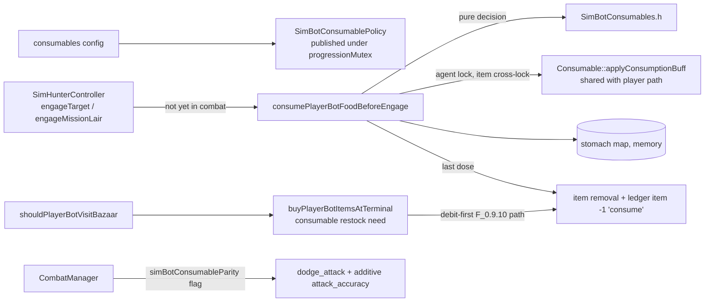

# Food and Drink for PlayerBots (P.10o / F_0.9.14) Implementation Plan

## Overview

Roster PlayerBots get a player-parity stomach (food and drink fill, max 100 each, digesting at the
player rate) and eat crafted consumables from their vault right before a fight they start. They
restock from the bazaar, like weapon and armor upgrades, whenever their stock of a configured item
falls below 10 doses. The shipped list is Vasarian brandy (mind), pikatta pie (defense) and
crispic (offense), and stays editable in Lua. A flagged combat seam makes the food buffs count in
bot combat the way they count for players.

Inserted before F_0.9.11 on the owner's request, as F_0.9.12 and F_0.9.13 were. Release version
`0.9.15`.

## Problem Statement

- A bot has no `PlayerObject`, so there is no stomach: `foodFilling`/`drinkFilling` live on the
  ghost (`PlayerObject.idl:73-77`, digest `PlayerObjectImplementation.cpp:1304` and `:2329-2338`:
  1 point per 18 s, max 100).
- The stock use path cannot run for a bot. `ConsumableImplementation::handleObjectMenuSelect`
  requires the item inside the creature (`isASubChildOf`) and returns before applying anything when
  the ghost is null. Bot items live in the vault bag (F_0.9.3), never on the body.
- Stock combat ignores two of the three food effects for an AiAgent:
  - `CombatManager::getDefenderDefenseModifier` adds `dodge_attack` (pikatta pie) only for a player
    defender (`CombatManager.cpp:~2128`).
  - `getAttackerAccuracyModifier`'s AI branch (`:~1991`) uses `AiAgent::getSkillMod("attack_accuracy")`,
    which returns the creature skill-mod list (buffs included) whenever it is nonzero. A crispic
    buff therefore **replaces** the bot's accuracy (normally `getChanceHit() * 100`) with the small
    food value: eating would make the bot worse.
  - Brandy is an attribute buff (max mind, focus, willpower) and already works for any creature.
- The bazaar BUY path (F_0.9.10) counts **items** per template, while a crafted stack holds several
  doses (brandy 6-10, pikatta pie 5-7, crispic 6-10).

## Owner decisions (2026-10-18 discovery)

| Question | Decision |
|---|---|
| What "at least 10 of each" counts | **Doses**: the sum of use counts over all held stacks of that template |
| How food reaches bot combat | **Flagged food seam**: for flagged roster bots only, add the buff-type `dodge_attack` to defense and add the buff-type `attack_accuracy` on top of the bot's existing AI accuracy; every other NPC is unchanged |
| When a bot eats | **Before fights the bot starts** (early-game Engage, lair engagement). An ambushed bot fights with whatever buffs it already has. **Amended 2026-10-19 after live verification:** also when the bot turns to fight an attacker on a travel leg (`defendAgainstInterceptor`), because production mission bots almost never start a fight themselves |
| Stomach durability | **Memory, digested lazily**: per-identity fill plus timestamp, survives bot death, resets to empty on server restart; no schema change, no tick task |

The owner also asked for a later hook: once grouping with players lands, a group leader's "take
foods" or "ok let's fight" should make grouped bots eat. This chunk leaves a `TODO(P.10 grouping)`
comment at the single eat entry point and codes nothing for it.

## Verification-time changes (2026-10-18/19)

Found by live verification, each re-reviewed by Codex:

1. **Accuracy seam fallback.** `AiAgent::getSkillMod` returns the creature skill-mod total when it
   is nonzero and only otherwise its fallback (template statistic, then `100 + 2 x level` for any
   accuracy mod). A food buff hid that fallback, so "total minus buff" fell to `getChanceHit()*100`.
   The fallback is now its own unchanged method, `AiAgent::getSkillModFallback` (IDL `@read`), and
   the seam restores it when the food is the only skill mod.
2. **Bazaar candidates by type.** A consumable need took every listing on the planet as a raw
   candidate and spent its load budget on the cheapest non-food items. `ConsumableEntry` carries the
   template's client game object type, the field buy-list entries match on.
3. **Travel engagements eat** (owner decision above): a third call site in
   `SimHunterController::defendAgainstInterceptor`.
4. **Gate-off removes food buffs** (also in Edge Cases).
5. Scenario defects: a flush before the ledger assertion, listing-fee credits for sellers, and no
   assertion on a counter without a harness baseline.

## Solution Architecture

1. **Derived stomach, not a tick.** Per identity, `SimBotStomach {food, drink, updatedAtMs}` in a
   `progressionMutex`-guarded map. Reads digest lazily and never write: `fill - (now - updatedAtMs) /
   18000` whole intervals, floored at 0, capped at 100. A write (eating) first materializes the
   digest: fill becomes the digested value and `updatedAtMs` advances by the **whole intervals
   consumed** (the partial interval is kept), or to `now` when the fill reached 0. So the next
   decrement time is always `updatedAtMs + 18000`. No task runs and nothing is persisted. Death keeps
   the fill (players keep their stomach through death); a restart empties it.
2. **Eat at the engage transition, then sleep until something can change.** Instead of a fixed
   timer, the eat path computes `nextEatCheckAtMs` from what blocked it:
   - every listed buff active → the soonest buff expiry;
   - stomach too full for the next wanted item → the time digestion frees enough room;
   - no doses → `noDoseRetrySeconds`, and the item becomes a restock need;
   - floored at `minRecheckSeconds` (30 s) so a fault can never spin.
   The deadline is computed **after** the apply step, from the actual remaining time of the buffs
   on the body (including the ones just created) and the post-eat stomach; a failed application
   contributes `minRecheckSeconds`. Buffs belong to the body, so a **spawn clears** the identity's
   deadline (the stomach fill is kept): a respawned bot eats at its next engage.
   Before that time the call returns after one map read, so `engageTarget()` (called every engage
   tick) costs nothing. This is the owner's "wait for it to drop, then eat again" rule, and stronger
   than a timer: no attempt is made while nothing could succeed.
3. **One shared buff constructor.** The buff-building cases of `handleObjectMenuSelect` for
   `EFFECT_ATTRIBUTE`, `EFFECT_SKILL` and `EFFECT_DURATION` move verbatim into a new native
   `Consumable::applyConsumptionBuff(CreatureObject*)`, which builds the buff and adds it to the
   locked consumer (Twi'lek +10 % duration included). The player
   path calls it, so player behavior is identical by construction (the F_0.9.13 `applyWornArmorReduction`
   pattern). The sim path calls it with the bot body. Configured items are validated at load: only
   attribute, skill or duration effects, no spice, no species restriction, no foraged food. Brandy is
   `EFFECT_ATTRIBUTE` (1); pikatta pie and crispic are `EFFECT_DURATION` (template value 2 = 0x02,
   a food `DurationBuff` carrying skill mods).
4. **Doses come off the vault stack; the last dose removes the item.** The sim path decrements the
   stack with `setUseCount(n - 1)`, never `decreaseUseCount()` (which destroys the object outside
   the vault's bookkeeping). At zero the item leaves through a new vault removal helper: destroy
   from bag and database, drop the `simbot_items` row, write an `item` −1 ledger row with
   `source = consume`, `ref_id` = object id. Intermediate doses write no ledger row (they change no
   item count) and are counted in telemetry. Like any object change, a dose survives a restart only
   after the next 5-minute delta save (a bot may get a dose back; never loses an item it still holds).
5. **Restock rides the debit-first BUY path.** A new `BuyNeed.consumable` per configured item whose
   held doses are below `minDoses` and that has no pending purchase of that template. Candidates are
   priced **per dose** (`price / useCount ≤ maxPricePerDose`), cheapest per dose first, at most one
   stack per template per visit, within `restockSpendFraction` of spendable credits and the existing
   `reserveCredits`. Visits are admitted by a per-identity `restockScanIntervalMinutes` timestamp, as
   armor upgrades are.
6. **Never sell food you mean to eat.** While the gate is on, held rows of every configured template
   are protected from SELL, like the equipped weapon and worn armor.
7. **Flagged combat seam.** A transient `AiAgent::simBotConsumableParity`, set at spawn for a roster
   body whose identity has a record and the consumables gate open, reset in `loadTemplateData` beside
   `simBotWornArmor`. Only that flag changes combat:
   - defense: a flagged AI defender adds `getSkillModOfType("dodge_attack", BUFF)` and the same for
     `private_dodge_attack`. The BUFF-typed read avoids `AiAgent::getSkillMod`'s template-stat
     fallback (the method is native and overridden on `AiAgent`), so only food counts;
   - accuracy: the AI branch computes its existing result with the buff-type `attack_accuracy`
     excluded, then adds that buff amount. An unbuffed flagged bot is therefore exactly unchanged.
   The flag follows the gate, not just the spawn: the slow-tick live-body reconcile (where armor
   reconciles, `SimPlayerManager.cpp:~18590`) sets or clears it on every live roster body when the
   gate result differs from the flag, so a hot-reloaded Lua toggle or a harness override takes
   effect without a respawn, and a closed gate never leaves a stale flag.

## Implementation Details

### 1. Pure policy header

**File**: `src/server/zone/objects/creature/simplayer/SimBotConsumables.h` (new)

Pure, gtest-covered, no engine locks. Named constants mirror the player source
(`kStomachMax = 100`, `kDigestIntervalMs = 18000`, cited to `PlayerObjectImplementation.cpp`).

- `digest(stomachSide, nowMs)` → `{fill, updatedAtMs}` with the whole-interval advance described in
  Solution Architecture 1; `msUntilRoom(fill, updatedAtMs, nowMs, needed)` → 0 when `needed` fits,
  else `(overflow - 1) * 18000 + (updatedAtMs + 18000 - nowMs)`.
- `ConsumableEntry {templateCrc, buffCrc, isDrink, minDoses, maxPricePerDose}` and
  `HeldStack {objectId, templateCrc, doses, filling}`.
- `chooseConsumptions(entries, stacks, buffActive, buffRemainingMs, stomach, nowMs, policy)` → the
  ordered list of `(entry, stack)` to eat now (list order; skip an active buff; skip a stack whose
  filling exceeds free room; prefer the stack with the fewest doses so partial stacks clear first)
  plus a blocked reason per entry (`buff_active`, `stomach_full`, `no_doses`).
- `nextCheckAtMs(blocked, buffRemainingMsAfterApply, stomachAfter, failedApplications, nowMs, policy)`
  → the deadline, computed after the apply step (soonest buff expiry, digest time for the smallest
  blocked filling, `noDoseRetrySeconds`, floored at `minRecheckSeconds`).
- `restockNeed(heldDoses, minDoses, pendingForTemplate)` → whether to buy.
- `pricePerDose(price, doses)` and `acceptsListing(price, doses, maxPricePerDose, ceiling)`.
- `foodAdjustedAiAccuracy(totalAccuracyMod, buffAccuracy, chanceHit, weaponTypeAccuracy)` → the
  seam arithmetic (existing rule applied to `total - buff`, then `+ buff`).

### 2. Consumable buff constructor (shared with players)

**Files**: `src/server/zone/objects/tangible/consumable/Consumable.idl`,
`ConsumableImplementation.cpp`

- Add `public native boolean applyConsumptionBuff(CreatureObject consumer);` (implementation-time
  change: it adds the buff itself instead of returning it, because returning a fresh `Buff*` out of a
  local `ManagedReference` lets engine3 release it on return). It handles
  `EFFECT_ATTRIBUTE`, `EFFECT_SKILL` and `EFFECT_DURATION`, and returns false for any other effect.
- `handleObjectMenuSelect` (cases at `:190-288`) replaces those three switch cases with a call to it; the
  skill-mod system messages stay in the player path. Other cases are untouched.
- Add `public int getFilling()` and `public unsigned int getBuffCRC()` accessors (neither exists
  today). `src/autogen/` regenerates (gitignored).

### 3. AiAgent flag

**Files**: `src/server/zone/objects/creature/ai/AiAgent.idl`, `AiAgentImplementation.cpp`

- `protected transient boolean simBotConsumableParity;` with setter and getter beside
  `simBotWornArmor` (`AiAgent.idl:97`); reset to false in `loadTemplateData` next to the armor flag.

### 4. Combat seam

**File**: `src/server/zone/managers/combat/CombatManager.cpp`

- `getDefenderDefenseModifier` (`:~2128`): the player block is unchanged. A separate `else if`
  branch for a flagged AiAgent defender adds `getSkillModOfType("dodge_attack", SkillModManager::BUFF)`
  and `getSkillModOfType("private_dodge_attack", SkillModManager::BUFF)`, so only food buffs count.
- `getAttackerAccuracyModifier` AI branch (`:~1991`): when flagged, read
  `getSkillModOfType("attack_accuracy", SkillModManager::BUFF)` and apply
  `SimBotConsumables::foodAdjustedAiAccuracy`. Unflagged agents take the unchanged code.
- `estimateDamageAfterMitigation` (F_0.9.6 target selection) is not changed: selection stays
  conservative.
- Both getters are protected (`CombatManager.h:~241`). Add one public read-only probe,
  `getSimBotConsumableCombatProbe(CreatureObject* body, CreatureObject* opponent)`, returning the
  body's accuracy as attacker (`getAttackerAccuracyModifier(body, opponent, body weapon)`) and its
  defense as defender against the opponent (`getDefenderDefenseModifier(body, opponent's weapon,
  opponent)`), through the real getters. Used only by the harness assertion and the inspect section.

### 5. Config, policy and gates

**Files**: `bin/scripts/managers/sim_player_manager.lua`, `SimPlayerManager.{h,cpp}`

- Lua, under `playerBotProgression` (read **before** opening any child table: the F_0.9.13
  stack-relative `LuaObject` rule):
  - `consumablesEnabled = false`
  - `consumables = { bazaarRestock = false, minDoses = 10, minRecheckSeconds = 30,
    noDoseRetrySeconds = 300, restockScanIntervalMinutes = 15, maxRestockLoadsPerVisit = 6,
    restockSpendFraction = 0.25, items = { {template, maxPricePerDose, minDoses?}, ... } }`
  - shipped `items` (owner-tunable): `object/tangible/food/crafted/drink_vasarian_brandy.iff`
    `maxPricePerDose = 1000`, `dessert_pikatta_pie.iff` `600`, `dish_crispic.iff` `400`; a per-item
    `minDoses` overrides the block value. The production seed listing is priced under these.
- `SimBotConsumablePolicy` parsed in the config refresh, validated against the object template
  (`ConsumableTemplate`: effect type, spice, species restriction, foraged); rejected entries are
  logged and counted (`consumables.rejectedEntries`). Published under `progressionMutex` with a
  signature so the PvP-tick refresh does not reset state (the F_0.9.5 lesson).
- `playerBotConsumablesGateEnabled(identityId)`: the reference shape (master → harness
  identity-scoped override → configured), plus vault available, item reconcile not pending,
  early-game gate open, identity has a training plan. Copies `playerBotArmorLoadoutGateEnabled`
  (`SimPlayerManager.cpp:9317`).
- `playerBotConsumableRestockGateEnabled(identityId)`: consumables gate **and** `bazaarBuy` gate
  **and** `bazaarRestock` (harness override scoped like `playerBotArmorBazaarUpgradesGateEnabled`, `:9351`).
- Harness gate setter registered beside `armorLoadout` (`:17016`, `:17066`).

### 6. Stomach and the eat path

**File**: `SimPlayerManager.{h,cpp}`

- State under `progressionMutex`: `progressionStomach` (identity → `SimBotStomach`),
  `progressionConsumableNextCheckAtMs`, telemetry counters (consumed by template, skipped by reason,
  last-dose removals).
- `snapshotPlayerBotConsumableStacks(identityId, out)`: copy held rows of configured templates under
  `progressionMutex`, release, then read `getUseCount()`/`getFilling()` per object under its own lock,
  one at a time (bounded by `loot.maxItemsPerBot`).
- `consumePlayerBotFoodBeforeEngage(identityId, agent)`, the single entry point (carries the
  `TODO(P.10 grouping)` comment):
  1. gate first; then one `progressionMutex` read of `nextCheckAtMs`; return if not due;
  2. snapshot stacks and stomach (no lock held across);
  3. `Locker(agent)`: read `hasBuff`/remaining duration per configured buff CRC, dead/incapacitated,
     species; release;
  4. `chooseConsumptions` → per choice: `Locker agentLock(agent); Locker itemLock(item, agent);`
     recheck the item is still in this identity's bag with doses > 0 and the buff is still absent,
     `applyConsumptionBuff`, `setUseCount(n - 1)`; release both;
  5. under `progressionMutex` (no object lock held): stomach += item filling, counters, store
     `nextCheckAtMs`;
  6. for a stack now at zero: the vault removal helper (below), outside all locks.
- `removePlayerBotConsumedItem(identityId, objectId)`: lock order item → bag (the F_0.9.3 order),
  `destroyObjectFromWorld` + `destroyObjectFromDatabase`, then under `progressionMutex` drop the row,
  decrement held count, append `item` −1 ledger `source = consume`. Idempotent if the row is gone.
- Diag event `CONSUME` (identity, template, doses left, stomach after) in `missiondiag.log` style.

### 7. Hunter call sites

**File**: `src/server/zone/objects/creature/simplayer/SimHunterController.cpp`

- `engageTarget()` (`:6438`) and `engageMissionLair()` (`:5963`): immediately before the
  `Locker agentLock(agent)` that calls `startCombat`, and only when the agent is not already in
  combat, call `consumePlayerBotFoodBeforeEngage`. No lock held at the call; the call never blocks
  combat (eat failures are telemetry only). Interceptor self-defense (`defendAgainstInterceptor`,
  `:6908`) is ambush and does **not** eat.

### 8. Spawn flag

**File**: `SimPlayerManager.cpp`, `spawnPveIdentityBody` (`:29602`, near `setSimBotWornArmor` `:29956`)

- Set `simBotConsumableParity` when the identity has a record and the consumables gate is open. Gate
  read happens before the agent lock (no `progressionMutex` under the agent lock).
- Clear `progressionConsumableNextCheckAtMs` for the identity (buffs died with the old body; the
  stomach stays).
- Slow-tick reconcile: for each live roster body, compare the gate result with the flag and fix it
  under the agent lock, gate evaluated before the lock.

### 9. Bazaar restock and SELL protection

**File**: `SimPlayerManager.cpp`

- `shouldPlayerBotVisitBazaar` (`:13874`): a consumable branch after armor, admitting a visit when
  the restock gate is open, some configured item is below `minDoses` with no pending purchase of
  that template, the per-identity `progressionConsumableRestockScanAtMs` is due, and the spend
  ceiling ≥ `bazaar.minPrice`. The dose snapshot runs before `progressionMutex` is taken.
- `buyPlayerBotItemsAtTerminal`: `BuyNeed.consumable` + `BuyCandidate.doses`. Raw candidates match the
  template CRC (the existing listing-template cache is used only to skip known mismatches). A
  matching consumable candidate is **always loaded** to read `getUseCount()`, since the cache holds
  no dose count and a stack's doses can change; loads are bounded by `maxRestockLoadsPerVisit`; acceptance via `SimBotConsumables::acceptsListing`; ranking by price
  per dose. Purchases keep the existing debit-first flow, keyed `(identity, auction)`; the pending
  check is "any DEBITED/RESOLVE_PENDING purchase of this template". Harness buyer isolation
  (F_0.9.13) applies unchanged.
- `collectPlayerBotProtectedConsumableOids`: every held row of a configured template while the
  consumables gate is open; called beside `collectPlayerBotProtectedArmorOids` (`:9365`).

### 10. Dashboard and inspect

**Files**: `SimPlayerManager.cpp`, `bin/web/aieconomy-dashboard/app.js`

- `playerBotProgression.gates.consumables`, `.gates.consumableRestock`; section
  `playerBotProgression.consumables` (consumed by template, skipped by reason, last-dose removals,
  restock purchases and skips, rejected entries).
- `getPlayerBotInspectJson` (`:26927`): `consumables {stomach {food, drink, max}, items [{template,
  doses, stacks, buffActive, buffRemainingSeconds}], nextCheckInSeconds, lastConsumed}`; gate-independent
  like the abilities section.
- `app.js`: a "Food & drink" table in the bot drawer and a counters panel beside Armor.

### 11. Harness

**File**: `SimPlayerManager.cpp`, `sim_player_manager.lua` (`playerBotParityTest`)

Ops: `setConsumablesGate`, `setConsumableRestockGate`, `grantVaultConsumable {template, doses}`,
`setStomach {food, drink, ageSeconds}`, `consumeBeforeEngage` (calls the entry point on the harness
body, since harness bodies never run hunter code), `assertStomach`, `assertConsumableDoses`,
`assertFoodBuff {buff, present}`, `assertConsumeCounters`, `assertCombatModifiers` (defense and
accuracy through `getSimBotConsumableCombatProbe` against a spawned `killTargetTemplate` creature,
buffed vs unbuffed), `respawnBody` (existing respawn op, to check the deadline reset).

Scenarios (all with `setBodyTemplate` pinned to a human body):

1. `food_eat_before_engage`: three items granted; one call eats all three; stomach and buffs match.
2. `food_no_reeat_while_buffed`: a second call inside the buff window eats nothing and makes no
   object loads.
3. `food_stomach_full_waits`: stomach preset near full; drink skipped with `stomach_full`;
   `nextCheckInSeconds` equals the digest time.
4. `food_digest_frees_room`: aged stomach digests; the next call eats.
5. `food_last_dose_removes_item`: a 1-dose stack is consumed; row gone, object destroyed, ledger
   `item` −1 `consume`.
6. `food_combat_seam`: pikatta pie raises defense by the buff value; crispic adds exactly its value to
   accuracy; an unflagged harness body is unchanged.
7. `food_gate_off_noop`: gate off → no eat, no flag, no protection; turning the gate on and off
   without a respawn sets and clears the flag on the live body.
7b. `food_respawn_reeats`: eat, respawn, next call eats again although the old buffs had time left;
   stomach fill carried over.
8. `food_sell_protected`: configured stacks are never listed.
9. `food_restock_below_min`: 4 doses held, a harness listing of 8 doses → bought, debit-first.
10. `food_no_restock_at_min`: 10 doses held → no visit admission and no purchase.
11. `food_restock_price_per_dose`: two listings; the cheaper per dose wins; one above
    `maxPricePerDose` is skipped.

Production stage (TRIP-verify, owner-armed gates): seed food listings; a real roster hunter buys,
then eats on a real engage (`CONSUME` events, buff on the body, stomach on inspect).

## Technical Considerations

- **Pattern usage**: F_0.9.13 armor (pure header, flagged combat seam, moved-verbatim player code,
  gate shape, harness ops), F_0.9.10 debit-first BUY, F_0.9.3 vault removal and ledger.
- **Locking & references**:
  - manager mutexes are never held across object locks; `progressionMutex` is never taken under the
    agent lock;
  - the eat apply step takes `Locker(agent)` then `Locker(item, agent)` (the F_0.9.13
    `Locker(copy, agent)` cross-lock), one item at a time;
  - item removal takes item → bag with no agent lock, as the vault paths do;
  - the hunter call happens with no lock held, before the existing `startCombat` lock;
  - `ManagedReference` for loaded items, released before the next lock step.
- **IDL impact**: `Consumable.idl` (one native method, accessors) and `AiAgent.idl` (one transient
  flag). Autogen regenerates; expect a wide incremental build.
- **C++ vs Lua**: the policy, stomach and seam are C++; the item list, thresholds, prices and gates
  are Lua.
- **Gating**: `consumablesEnabled` and `consumables.bazaarRestock` ship **off**. Real mutations (doses,
  item removal, purchases) are P.10-approved holdings changes for roster identities only, after a
  live harness receipt.
- **Dashboard**: section 10.
- **Live verification**: section 11 harness plus the production stage; universal no-crash and no
  new error signature.
- **Edge cases**:
  - a body that dies between snapshot and apply: the post-lock recheck skips it (no dose taken);
  - an item sold, moved or destroyed in between: the bag recheck skips it;
  - attribute buffs (brandy) re-eaten while active are disallowed by policy, unlike stock, to honor
    "wait for it to drop";
  - Twi'lek bodies get the stock +10 % duration through the shared constructor;
  - Trandoshan/Wookiee-only foods are rejected at config load;
  - a server restart empties stomachs (accepted);
  - closing the gate on a live body clears the flag **and** removes the configured food buffs
    (implementation-time finding): unflagged, stock AI accuracy would take a crispic
    `attack_accuracy` buff as the bot's whole accuracy until the buff expired;
  - a looted configured food is protected from SELL and eaten like a bought one;
  - brandy's mind buff does not count toward the F_0.9.13 armor buff rule (that rule keys on the
    doctor buff CRCs); out of scope.

## Files to Modify/Create

1. `src/server/zone/objects/creature/simplayer/SimBotConsumables.h` (new): pure stomach, choice,
   restock and seam policy.
2. `src/server/zone/objects/tangible/consumable/Consumable.idl` (modify): `applyConsumptionBuff`,
   accessors.
3. `src/server/zone/objects/tangible/consumable/ConsumableImplementation.cpp` (modify): shared
   constructor, player path calls it.
4. `src/server/zone/objects/creature/ai/AiAgent.idl` (modify): `simBotConsumableParity`.
5. `src/server/zone/objects/creature/ai/AiAgentImplementation.cpp` (modify): reset in
   `loadTemplateData`.
6. `src/server/zone/managers/combat/CombatManager.{h,cpp}` (modify): flagged defense and accuracy
   seam; public read-only `getSimBotConsumableCombatProbe`.
7. `src/server/zone/objects/creature/simplayer/SimPlayerManager.h` (modify): policy, state,
   declarations.
8. `src/server/zone/objects/creature/simplayer/SimPlayerManager.cpp` (modify): config, gates, stomach,
   eat path, removal, restock, protection, spawn flag, dashboard, inspect, harness.
9. `src/server/zone/objects/creature/simplayer/SimHunterController.cpp` (modify): two eat call sites.
10. `bin/scripts/managers/sim_player_manager.lua` (modify): gates, `consumables` block, 11 scenarios.
11. `bin/web/aieconomy-dashboard/app.js` (modify): drawer table and panel.
12. `src/tests/SimBotConsumablesTest.cpp` (new): policy gtests.
13. `docs/ARCHI.md`, `docs/1-plans/ROADMAP_p10-playerbot-parity.md`, `docs/ai-pve-playerbot-design.md`
    (modify at release).

## Type Definitions

- `SimBotStomach {int food; int drink; uint64 updatedAtMs;}` (memory).
- `SimBotConsumablePolicy {bool enabled; bool bazaarRestock; int minDoses; int minRecheckSeconds;
  int noDoseRetrySeconds; int restockScanIntervalMinutes; int maxRestockLoadsPerVisit;
  float restockSpendFraction; Vector<ConsumableEntry> items; String signature;}`.
- `SimBotConsumables::ConsumableEntry`, `HeldStack`, `Choice`, `Decision {choices, blocked}` (no deadline: `nextCheckAtMs` is a separate post-apply function).
- `BuyNeed.consumable`, `BuyCandidate.doses` (local structs in `buyPlayerBotItemsAtTerminal`).

## Performance & Cost Impact

- The eat check on each engage tick is one mutex read until `nextCheckAtMs`; the full path runs at
  most once per buff window or digest window per bot.
- Dose snapshots load at most the bot's held configured stacks (≤ 80, typically 3-6), only on a due
  eat check or a bazaar admission check.
- Restock adds at most `maxRestockLoadsPerVisit` object loads per visit.

## Backward Compatibility

- No schema change. `simbot_items` gains rows only through the existing BUY path; `consume` is a new
  ledger `source` value in an existing column.
- Gates off: no stomach, no flag, no protection, no restock; combat is byte-identical for every
  creature.
- The player consumable path is unchanged in behavior (shared constructor moved verbatim).

## Test Impact

- New `SimBotConsumablesTest.cpp`: digest and room timing, choice ordering and blocked reasons,
  `nextCheckAtMs` (soonest of buff expiry, digest, floor), restock need by doses and pending,
  price-per-dose acceptance, the accuracy seam arithmetic (unbuffed flagged = unchanged).
- Existing `SimBot*` gtests (170) must still pass, run with the server stopped.
- `LuaMobileTest` is unaffected (no new mobiles); `luac -p` on the Lua file.
- Live: the 12 harness scenarios, regressions of the existing BUY/SELL/loadout/armor scenarios, and a
  production stage with owner-armed gates.

## To-dos

### Phase 1: Policy, shared buff constructor, combat seam

- [x] `SimBotConsumables.h` with stomach, choice, restock, price and seam functions
- [x] `Consumable::applyConsumptionBuff` + accessors; player path calls it (behavior unchanged)
- [x] `AiAgent::simBotConsumableParity` flag, reset in `loadTemplateData`
- [x] `CombatManager` flagged defense and accuracy seam + public combat probe
- [x] `SimBotConsumablesTest.cpp`

### Phase 2: Config, gates, stomach and eating

- [x] Lua `consumablesEnabled` + `consumables` block (default off), parse order before child tables
- [x] Policy parse, template validation, signature-guarded publish
- [x] `playerBotConsumablesGateEnabled` / `playerBotConsumableRestockGateEnabled` + harness overrides
- [x] Stomach map, stack snapshot, `consumePlayerBotFoodBeforeEngage` with `TODO(P.10 grouping)`
- [x] `removePlayerBotConsumedItem` + `consume` ledger row
- [x] Hunter call sites in `engageTarget` and `engageMissionLair`; spawn flag + deadline reset;
  slow-tick flag reconcile

### Phase 3: Bazaar restock and SELL protection

- [x] Visit admission branch in `shouldPlayerBotVisitBazaar`
- [x] Consumable `BuyNeed`, dose-aware candidates, price-per-dose ranking, pending rule
- [x] `collectPlayerBotProtectedConsumableOids` in SELL

### Phase 4: Observability, harness, docs

- [x] Dashboard gates and `consumables` section; inspect `consumables`; `app.js` table and panel
- [x] Harness ops and the 12 scenarios
- [x] Build warning-clean, `luac -p`, gtests with the server stopped
- [x] Live verification (TRIP-verify) including the production stage
