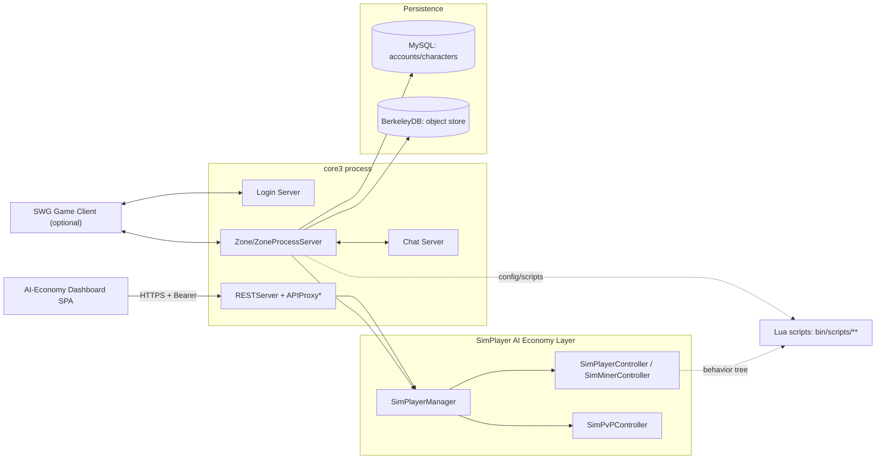

# SWGSolo (Core3) Architecture Documentation

## 1. How to Read This Document

**SWGSolo** is a heavily-modified fork of **Core3**, SWGEmu's C++ server emulator for *Star
Wars Galaxies* (Pre-CU). Audience: an AI coding agent (the project's primary collaborator)
starting without context; `TRIP-1-plan` / `TRIP-2-implement` require reading it. §2-11 are
inherited engine background; §12-13 cover this fork's AI Economy (SimPlayers, PlayerBots) and
AI PvP / Jedi layers, where new plans almost always land.

## 2. Overview

Core3 serves a 2003-era MMO: zoned persistent world, scripted NPCs, crafting/resource economy,
combat and a Lua quest layer, over SWG's binary protocol. This fork (`TrigsC/SWGSolo`, tracking
`swgemu/Core3` as `upstream`) turns it into a **single-player-capable AI-driven economy
sandbox**: hundreds of autonomous NPCs gather, craft, fight and rank up so the world stays alive
with no humans online. New behavior is **simulation-only by default**; the one approved
exception is the P.10 PlayerBot parity line (§12, PlayerBot parity line, "Policy").

## 3. Technology Stack

- **Language**: C++14 (core), Lua 5.x (logic/config), some Go (`idlc-go`, IDL compiler rewrite).
- **Build**: CMake 3.7+ + Ninja, Clang ≥16 (preferred) or GCC ≥5.4, `ccache`, 64-bit only.
- **Persistence**: MySQL/MariaDB (`libmariadb-dev`) for accounts/characters; Berkeley DB
  (`libdb5.3`) object store for distributed objects; local `navmesh.db`.
- **Networking**: custom SWG protocol (login/zone/ping/chat) over UDP/TCP; `libcpprest` powers
  the HTTPS `RESTServer` (Bearer token, TCP 44443) for the dashboard.
- **Testing**: GoogleTest/GoogleMock (`MMOCoreORB/utils/googletest-release-1.13.0`) compiled
  into the server binary (see Testing Strategy).
- **Container**: Docker (Debian bookworm) is the only supported dev/build/run environment (§6).
- **Dashboard frontend**: static 3-file SPA (HTML/CSS/vanilla JS) in
  `MMOCoreORB/bin/web/aieconomy-dashboard/`, no framework, no build step.

## 4. Project Structure

```
workspace/Core3/                          # git repo root (branch: miner-ai; remotes: origin=TrigsC/SWGSolo, upstream=swgemu/Core3)
├── docs/                                 # design docs + TRIP docs (1-plans, 2-changelog, 3-code-review, 4-unit-tests, 5-tuto)
├── docker/                               # Dockerfile, compose, build.sh/run.sh — the dev environment
├── linux/, wsl2/                         # native bootstrap scripts, unused by this fork
└── MMOCoreORB/                           # the server source tree
    ├── CMakeLists.txt
    ├── src/
    │   ├── main.cpp, CoreProcess.h       # process entry point
    │   ├── server/
    │   │   ├── zone/                     # THE GAME (§8): objects/ (entity types), managers/ (~45 singletons), Zone.idl
    │   │   ├── login/, ping/, status/, chat/
    │   │   ├── web/                      # RESTServer + APIProxy* (§11)
    │   │   ├── db/                       # MySqlDatabase / MantisDatabase (BDB object store)
    │   │   └── metrics/
    │   ├── templates/                    # static game-data schema (.iff-derived)
    │   ├── terrain/, pathfinding/        # heightmap terrain + Recast navmesh
    │   ├── tre3/, client/                # client asset/protocol glue
    │   ├── autogen/                      # GENERATED from .idl — never hand-edit
    │   └── tests/                        # GoogleTest sources (core3tests, linked into core3)
    ├── utils/engine3/                    # submodule: ORB, Lua bindings, Locker/Reference, net — never modified
    ├── bin/                              # RUNTIME tree (built `core3` lands here)
    │   ├── conf/                         # config-local.lua, config.lua, adminusers.lst, ssl certs
    │   ├── scripts/                      # ALL LUA — managers/, ai/, screenplays/, commands/, object/, mobile/, skills/
    │   ├── web/aieconomy-dashboard/      # dashboard SPA
    │   └── databases/, navmeshes/, log/
    └── sql/                              # schema migrations
idlc-go/                                  # Go IDL compiler reimplementation
```

## 5. Core Architecture Principles

- **IDL-generated distributed objects** — entities are declared in `.idl` and generated into
  `src/autogen/` (§9).
- **Reference-counted, lock-guarded objects** — `Reference<T>`/`ManagedReference<T>` plus
  explicit `Locker` discipline. **#1 stability rule (owner-stated): match the nearest existing
  caller's lock choreography exactly.** A mismatched lock/mount sequence caused the P.4.4
  vehicle-mount orphan regression.
- **Manager-per-subsystem** — singletons under `server/zone/managers/*` (`CombatManager`,
  `ResourceManager`, `JediManager`, `AiEconomyManager`, ...), each owning its state with C++ and
  Lua surfaces.
- **C++ core, Lua behavior/config** — behavior trees, screenplays, commands and tunables live in
  Lua under `bin/scripts/` (§10); new tunables default to a Lua config entry, not a constant.
- **Docker-only incremental dev loop** (§6).

## 6. Build System & Toolchain

Everything runs in the `swgemu_server` container. The host mount
`/srv/games/swgemu-core3/workspace` is **unreliable**: verify with a real `ls`/`cat`, else
`docker cp` in/out and `chown 44400:44400` (the in-container `swgemu` user).

```bash
# Build (incremental)
docker exec -u swgemu -e TERM=xterm swgemu_server bash -lc 'build'
#   TERM=xterm is REQUIRED (the script calls `clear`).
#   `build clean` full rebuild | `build nocache` clears ccache | `build asan` RelWithDebInfo+ASan

# Run / restart the live server (~40-50s startup)
/home/swgemu/bin/run
#   RESTARTING IS THE OWNER'S CALL. Sole exception: explicit /TRIP-verify, whose guarded script
#   may disconnect test players and restart after a green build (GDB shutdown first, then
#   force-kill only the exact core3 process).
```

CMake options: `BUILD_IDL`, `COMPILE_TESTS`, `ENABLE_ASAN`/`TSAN`/`UBSAN`. Debug builds are
`-Werror`-strict — **build warning-clean before handing work back**.

## 7. Configuration

- **`bin/conf/config-local.lua`** — runtime config (DB credentials, ports, toggles), overrides
  `config.lua`; never committed with secrets. **`bin/conf/features.lua`** — global feature flags.
- **`bin/scripts/managers/*.lua`** — per-manager tunables; `sim_player_manager.lua` holds every
  AI-economy knob and is where new features expose owner-tunable, default-off gates.
  **The running server re-reads it from disk continuously**: a syntax error is hit within
  seconds (previous config kept), so `luac -p` any edit immediately.
- Compiled constants are the exception; prefer Lua so behavior tunes without a rebuild.

`sim_player_manager.lua` blocks by release (all default-off unless noted):

| Release | Blocks / gates |
|---|---|
| P.4-P.9 | demand thresholds, `enableStationTravel`, `vehicleConfig.enableVehicleMechanics`, recovery `dryRun`, `ticketCollectorTravel` (+`interiorContainmentMarginMeters`), `cellNavDiag.{enabled,logging}` |
| F_0.8.0/0.8.1 | `structureTraversal` (`enabled`, `logging`, `hollowEscalation*`, `farSideEgress`, `hollowDoorEgress.*`, `zeroClip.{enforce,rejectionCap,walkableConfirm,walkableToleranceRatio}`) + `structureTraversalTest` matrix |
| F_0.9.0/0.9.1 | `playerBotProgression` (`enabled`, `flushIntervalSeconds`, `reaper.*`, `awardKillXp`, `killXpRate` 1.0 = parity) + `playerBotParityTest` (matrix, `killTargetTemplate`) |
| F_0.9.5 | `trainingEnabled`, `trainingMaxPerTick`, `trainingSweepBatch`, `trainingPlans` (`name`, `goalSkill`, `profession`, `weaponTemplate`, `weaponType`); `pveConfig.novice` (`enabled`, `retireLegacyHunters`, `bodyTemplate`, distribution, `bodyHam` 800 = starting player) |
| F_0.9.6 | plan `goalSkills`; `earlyGameEnabled` + `earlyGame` (`realWeaponDamage`, XP-type loadouts, grind anchors, level band/TTK target selection, `avoidGroupAggroTargets`, spawner roaming, `unreachableSkip*`, survival fractions, `deathAvoid*`, `combatTelemetry`, `movementTelemetry`); top-level `combatDiag` (`simcombat.log`) |
| F_0.9.7 | `combatAbilitiesEnabled` + `combatAbilities` (`specialAttackChancePercent`, `preferFreeStateAbilities`, `hamReserveFraction`, `freeStateRetrySeconds`, `excludedCommands` = taunt/warcry1/warcry2, `usageHistorySize`, later `avoidAreaAttacksNearLair`) |
| F_0.9.8/8b | plan `linePriority` / `parallelXpStreams` (absent = old behavior); `missionBoard.{lairEngagementHold, lairRetargetIntervalMs, waveDisengage, waveDeaggro, travelCombat, travelRestHamPct, travelMaxFleeLegs, attackerRecognition, lairRetreatDefense, stockPlacement, revealRelocateEnabled, lairRevealDeferMaxCycles}`; `pveConfig.marketDispatch.progressionDispatch` (`enabled`, `grindFallback`, `grindFallbackMinutes` 5..240); `deferredXpTypes` = medical, crafting_medicine_general, crafting_general. **Committed ON (owner, 2026-10-13)** — the first default-off exception; the progression master gates and `novice` stay off. |
| F_0.9.2 (v0.9.9) | `awardMissionCredits`, `buffPayment` (`enabled`, `doctorFeeCredits`), `ledgerRetentionDays` (0 = forever) |
| F_0.9.3 (v0.9.10) | `lootEnabled` + `loot` (`maxItemsPerBot` 80, `arriveMeters`, `maxDetourMeters` 64, `claimTtlSeconds`, `maxClaimsPerBot`, `stepTimeoutSeconds`) |
| F_0.9.9 (v0.9.11) | `bazaarSell`, `bazaarSaleBacklogMax`, `bazaar` (`markup` 3.0, `minPrice`, listing caps, `listingDurationHours`, `visitCooldownMinutes`, `maxDetourMeters`, sweep cadence, `drainOnDisable`) |
| F_0.9.10 (v0.9.12) | `bazaarBuy`, `bazaar.buy` (`reserveCredits` 5,000, `maxPurchasesPerVisit`, `maxPendingPerBot`, `candidateScanLimit`, `maxObjectLoadsPerVisit`, `executeTimeoutSeconds`); per-plan `buyList` (`template`, `quantity` 1..5, `maxPrice`; ≤8, shipped empty) |
| F_0.9.12 (v0.9.13) | `weaponLoadout`, `loadout` (`minUpgradePercent` 10, `fullSweepMinutes`, `bazaarUpgrades`, `upgradeSpendFraction` 0.5, `upgradeScanIntervalMinutes`, `maxUpgradeLoadsPerVisit`) |
| F_0.9.13 (v0.9.14) | `armorLoadout`, `loadout.armor` (`minUpgradePercent`, `assumedArmorPiercing`, `damageTypeWeights`, `bodyRaces` `{body, race}` pairs, `bazaarUpgrades`, `upgradeSpendFraction`, `maxUpgradeLoadsPerVisit`, `bodyHamBaseline`) |
| F_0.9.14 (v0.9.15) | `consumablesEnabled`, `consumables` (`bazaarRestock`, `minDoses` 10, `minRecheckSeconds`, `noDoseRetrySeconds`, `restockScanIntervalMinutes`, `maxRestockLoadsPerVisit`, `restockSpendFraction`, `items` = `{template, maxPricePerDose, minDoses?}`: Vasarian brandy, pikatta pie, crispic) |
| F_0.9.15 (v0.9.16) | `groupingEnabled`, `grouping` (`roomName` LFB, offer TTL 180 s, `defaultReplies` 2, `maxRepliesCap`, reply delays/gap, `availabilityChancePercent`, request cooldown and room rate, `maxGroupedBots` 10, `maxBotsPerLeader` 9, join delay, `followMinMeters`/`followMaxMeters`, `repathMoveMeters` 3, `followTickMs` 750, `routeDistanceMeters`, `maxReplansPer10Min`, `assistRadiusMeters`, `leaderOfflineGraceSeconds`, `vocabulary` roles/gear/tiers/status/leave, `lines`) |
| F_0.9.17 (v0.9.18) | `grouping.missionsEnabled` (false), `grouping.missions` (`maxGrabCount` 20 sanity cap, `bearingToleranceDeg` 22, `holdShortMeters` 60, `missionTimeoutMinutes`, `grabBatchTimeoutSeconds`, `assistLeaderTarget`/`assistLeaderRadiusMeters`), `vocabulary.mission` (grab, mission/lair nouns, run, skip, directions), mission and `clonedNoBuffs` lines; `bin/conf/config.lua` `Core3.MissionManager.MaxActiveMissions` (2); harness `playerBotParityTest.onlyScenarios`/`continueOnFailure`/`maxRunMinutes` |
| F_0.9.18 (v0.9.19) | `grouping.tacticsEnabled` (false), `grouping.tactics` (`pullRadiusMeters` 64, `pullTimeoutSeconds` per phase, `tagTimeoutSeconds`, `spinStartMeters` 20, `spinStandMeters`), `vocabulary.tactics` (pull, spinPoll, spinOn, spinOff, eat, backOff, lairAttack), tactic lines, `grouping.missions.leadStopMeters` (40) |
| F_0.9.19 (v0.9.20) | `healingEnabled` (false), `healing` (`playerHealsBots`, `botHeals`, `selfHeal`, `groupHealThreshold` 0.70, `selfHealThreshold` 0.60, `selfCriticalFraction` 0.35, `maxApproachMeters` 32, `applyRangeMeters` 6, approach/apply timeouts, `bazaarRestock`, `minDoses` 20, `restockSpendFraction`, `restockScanIntervalMinutes`, `maxRestockLoadsPerVisit`, `items` = five crafted stims `{template, maxPricePerDose}`), `grouping.vocabulary.heal`, heal lines |
| F_0.9.20 (v0.9.21) | `harvestEnabled` (false; needs `lootEnabled`), `harvest` (`sell`, `sellThresholdUnits` 500, `pricePerUnit`, `minQualityFactor`, `targetStockUnits` 50k/family, snapshot and load caps), `loot.discardJunkBelowFreeSlots`/`discardJunkTargetFreeSlots` (5/10; 0 = off), `bazaar.resourceListingReserve` (10 of `maxListingsPerBot` 25, clamped to stock `MAXSALES`), `scout` in `earlyGame.deferredXpTypes`, brawler `goalSkills` + Scout 4x4x |
| F_0.9.16 (v0.9.17) | `grouping.directivesEnabled` (false), `buffCities`, rally `rallyArriveMeters`/`Min`/`Max`/`ReleaseMeters`/`HoldMaxMinutes`, `shuttleMinSavingsMeters` 1000, `rebuffCheckSeconds`/`rebuffVisitResetSeconds`, `groupBuffTimeoutSeconds` 600, line delays, `vocabulary.follow`/`ready`/`rally` (buff, meet, landmarks), `places` (cities, outposts, custom x/y), rally `lines` |

The sim layer alone restores roster PlayerBot weapon-template stats after shared AI weapon-stat
setup; synthetic harness identities stay outside that path.

---

## 8. Game World / Server Architecture

- **Process model**: one `core3` binary hosts the zone server(s) plus login, ping, status and
  chat servers, wired by `main.cpp`/`CoreProcess`.
- **Zones** (`Zone.idl`, `GroundZone`, `SpaceZone`) are per-planet simulation containers ticked
  by `ZoneProcessServer`.
- **Objects**: `SceneObject` → `TangibleObject`/`IntangibleObject` → `CreatureObject` →
  `AiAgent` (NPCs) / players / SimPlayers (§12). Static data comes from `templates/`.
- **Pathfinding**: `terrain/` + `pathfinding/recast`. **Only cities/POIs are navmeshed**; in open
  wilderness (where resources spawn) `findPath` degrades to a 2-node "direct fallback". This is
  the root constraint behind the overland and station-travel work in §12.
- **Persistence**: MySQL rows for accounts/characters; BDB object store (`server/db`) for the
  object graph, keyed by ORB object IDs.

## 9. Distributed Object / IDL Codegen System

1. A `.idl` file (Java-like DSL) declares fields, methods and annotations (`@json`, `@read`,
   `@dirty`, ...).
2. The IDL compiler (`BUILD_IDL`; Go rewrite in `idlc-go/`) generates `src/autogen/`: interface,
   `*Implementation` skeleton (hand logic in a co-located `*Implementation.cpp`), RMI
   stub/adapter, GoogleMock doubles.
3. Hold objects via `Reference`/`ManagedReference`, take the `Locker` before mutating, and copy
   the nearest existing caller's lock sequence.
4. **Never hand-edit `src/autogen/`** — it is gitignored and regenerated at build, so an additive
   `.idl` method costs one committed line (F_0.9.1 added `PlayerManager::getExperienceMultiplier()`
   this way). The cost is build fan-out: that one line took an incremental build from 17 to 89
   targets.

## 10. Lua Scripting Layer

- Bridged by engine3 `engine/lua/*` (`LuaObject`, `LuaFunction`, exception translation).
- `bin/scripts/managers/` (config + callbacks), `ai/` (behavior trees), `screenplays/`,
  `commands/`, `object/`, `mobile/`, `skills/`.
- **Behavior trees vs C++ controllers**: `simMiner.lua` is a deliberate no-op so
  `SimPlayerController` is the sole mover (no dual-driver fight with `GeneratePatrol`).
  `simHunter.lua`/`simPvp.lua` override **only** the IDLE slot: the controller drives movement,
  the stock tree drives combat (call `activateAiBehavior(true)` on engage to wake it).
- **`LuaObject` field reads are stack-relative.** `getBooleanField` and siblings read the table
  on top of the stack (`lua_gettable(L, -2)`). A parent read while a child table from
  `getObjectField` is pushed silently reads the child and returns the default. Read parent
  fields before opening a child, or after popping it (F_0.9.13: `armorLoadout = true` parsed as
  false). Presence detection = read a field twice with two defaults; never poke the stack with
  `lua_getfield`.
- **Safe Lua↔C++ wrapping (crash class).** `AiAgent(pObj)`/`LuaAiAgent(pObj)` `dynamic_cast`;
  in debug (`DYNAMIC_CAST_LUAOBJECTS`) a wrong type fires `E3_ASSERT` → `abort()`, which
  `pcall`/`safeCall` cannot catch (release builds: UB). Gate first with a cast-free predicate
  (`SceneObject(pObj):isCreatureObject()` / `:isAiAgent()`), and mirror agent-only reads onto
  `LuaCreatureObject` via `CreatureObject::asAiAgent()` (e.g. `LuaCreatureObject::isSimPlayerBot`,
  F_0.7.2 SIGABRT fix).

## 11. Web/REST Layer (AI-Economy Dashboard)

- **`src/server/web/RESTServer`**: HTTPS (`libcpprest`), Bearer-gated, port 44443.
- **`APIProxy*Manager`** (`AiEconomy`, `Player`, `Guild`, `Statistics`, `Config`, `Chat`,
  `Object`): thin read-mostly per-manager facades — the pattern for exposing new state.
- **`SimPlayerManager`** assembles the JSON sections (`minerActivity`, `coveragePlanner`,
  `minerRecovery`, `pathValidationDiagnostics`, `simulatedAcquisition`, `vehicleMechanics`,
  `stationTravel`, `pveActivity`, `playerBotProgression`, ...).
- **Per-object detail endpoints** keep the poll small: `GET /v1/aieconomy/playerbot/(\d+)/`
  (`handlePlayerBotGET` → `getPlayerBotInspectJson`, F_0.9.7), built on demand, 404 for an
  unknown identity — copy it for any "click a row for detail" surface.
- **Frontend** `bin/web/aieconomy-dashboard/` (`index.html`/`app.js`/`styles.css`): hash-routed
  (`#/command`, `#/warfront`, `#/wilds`, ...), deployed by copying files (no restart). Bot names
  open a detail drawer fed by the endpoint above.
- The live endpoint is ground truth for any AI-economy claim:
  `curl -sk https://127.0.0.1:44443/v1/aieconomy/dashboard/ -H "Authorization: Bearer <token>"`

## 12. AI Economy Simulation Layer (SimPlayers) — active development focus

Layered on the stock `AiAgent`/`CreatureObject` hierarchy. Living design docs:
`docs/ai-miner-navigation-design.md` (P.4), `docs/ai-cell-navigation-design.md`,
`docs/ai-pve-playerbot-design.md`, `docs/1-plans/ROADMAP_p10-playerbot-parity.md`.

### Core classes

- **`server/zone/objects/creature/simplayer/SimPlayerManager.{h,cpp}`** — the "economy brain":
  roster, demand/supply simulation, resource targeting, cross-planet coverage, the PlayerBot
  stores, and all dashboard JSON (§11). The largest, most-touched file.
- **`SimPlayerController.{h,cpp}`** — per-NPC movement base (`SimMinerController` for gatherers):
  path/sample lifecycle, stuck-watchdog (bounded re-path → `onPathFailed`), activation trust
  (`isActivationTrustAcceptable()` = `verifiedPath` or overland `directOverland`).
- **`SimPvPController`** (§13) and **`SimHunterController`** (PvE, below) are its siblings.

### Movement and cell navigation (P.4-P.9)

- **Cell-aware `moveTo`** (P.6.5b): optional target cell; world position for distance math,
  cell-local for the path request; path-node cells survive into `PatrolPoint`s. Outdoor callers
  (all miners) are unaffected. **`findNextPosition` assumes one coordinate space per comparison**
  — keep world and cell-local forms separate (`tuto_0.4.11.md`).
- **Cell-nav stack** (F_0.4.7-F_0.4.11): cell entry adopts the cell on `findNextPosition`'s
  duplicate-skip branch (no teleport-into-wall); cell egress
  (`beginCellEgressIfNeeded`) portal-follows to an exterior then resumes; multi-door starports use
  `BuildingObject::getNearestExteriorPortalPoint`; gated `ticketCollectorTravel` walks to the
  collector in the enclosed hollow (`resolveStarportInteriorWaypoint`, tri-state, bounded
  horizontal containment margin) with bounded retries, outdoor recovery and an idempotent PvP
  arrival OID barrier. `CellNavDiagLog` → `bin/log/cellnav.log` (gate `cellNavDiag.logging`).
- **Structure traversal (P.9 / F_0.8.0)** — explicit state machine on `SimPlayerController`:
  `StructureTraversalPhase` (`Idle→ApproachDoor→InteriorRoute→Egress→Reentry→CombatPaused→Resuming`)
  with a `traversalGeneration` **separate from** the movement generation, so combat can cancel a
  path task without cancelling traversal intent. Bounded hollow escalation rescues bots stranded
  in a starport hollow. **D2b far-side egress**: from inside a starport the pathfinder routes to
  the far door via the *nearest* portal back into the hollow — a path that **succeeds while making
  no progress**, invisible to the failure-only repair ladder. `acceptFoundPath` rejects it and
  retargets to the nearest reachable non-hollow exit cell, exempting destinations in the hollow
  (multi-hop transit lands on the pad). **Never force a bot out of a hollow that is its
  destination.**
- **Adoption (F_0.8.1)** — machinery is not adoption: `enterStructure()` once had only the
  harness as caller. Rule: a cell-bearing destination is a building entry and goes through
  `enterStructure`, not bare `moveTo`. Migrated: `SimHunterController` (buff providers),
  `SimPvPController` (collectors, starport waypoints), guarded on a non-null cell (a hollow is a
  null cell and stays outdoor); where the legacy call was `moveTo`, the guard also tests the gate,
  since `enterStructure`'s null-cell fallthrough calls `moveToInterior`. **Miners are not
  migrated** (station travel lands them outdoors). `acceptFoundPath` is a non-virtual template
  method (invariants + `virtual acceptFoundPathHook`). **`exitStructure` is NOT adopted**:
  production bots leave via the legacy egress ladder (`F_0.8.2_traversal-egress-adoption.plan.md`).
- **Test-oracle vs production telemetry (F_0.8.1)** — harnesses assert on **per-agent** tallies
  (monotonic `std::atomic` on `SimPlayerController`, not reset by `clearStructureTraversalState`),
  never on global dashboard aggregates, which any world bot can move. A destroyed body's counters
  fold into a per-slot carry in `destroyStructureTraversalTestBot`, under the agent lock.
- **Post-lock lifecycle recheck (F_0.8.1)** — any pre-lock guard (e.g. `agent->getZone()` in
  `checkArrival`) needs the same check after `Locker locker(agent)`: another thread may have
  destroyed the agent under that lock meanwhile.
- **Harness single-writer pattern** — the 26-scenario `structureTraversalTest` matrix (AI
  `simTraversalTest.lua`) holds its cursor under `structureTraversalTestMutex` per invocation but
  schedules tasks **outside** it: notify hooks take that mutex from threads holding agent locks
  (harnessMutex → agentLock vs agentLock → harnessMutex = ABBA). Log:
  `StructureTraversalDiagLog` → `bin/log/structuretraversal.log`.
- **Zero-clip (D7)**, observe + enforce, default-off (~19 ms p95/path): the probe
  (`probeEmittedPathClearance`) runs on the pathfinding worker before delivery; results are
  explicit (`clear`/`would_block`/`skipped`/`truncated`/`error`), worst-evidence-first.
  Enforcement re-asks up to `zeroClip.rejectionCap` then walks the route; it fails **open** (a
  mover that cannot see must still move), while harness oracles fail **closed**. Off-thread
  snapshots must be `SortedVector<ManagedReference<TreeEntry*> >`, never raw
  `InRangeObjectsVector`. Chord rays through stairs/bridge decks hit solid mass;
  `zeroClip.walkableConfirm` checks flagged chords against the navmesh. `getRecastPath`'s
  `float& len` is **not** a length (relative comparator only).
- **Shipped state (v0.8.2, owner)**: traversal master gate, `zeroClip.exitSetEnabled`,
  `farSideEgress`, `hollowEscalationEnabled`, `hollowDoorEgress.*`, `crossBuildingStaging` are ON;
  zero-clip probe/enforce, all traversal/cell-nav logging and the harness are OFF (no `ST_PHASE`
  traces by default).

### PvE hunters (`SimHunterController`, P.8)

- **Loop**: market-driven mission hunt (travel → terminal → held offer → real lair → pull → kill →
  harvest) closing the crafter→hunter demand loop; also owns the gated cross-planet buff trip.
  `SimPlayerManager` owns offers, dispatch and routes. Combat is **real**
  (`CombatManager::startCombat`); bodies spawn `PLAYER | ATTACKABLE`, faction 0, with player-safe
  targeting: the `AiAgentImplementation::isAttackableBy` mirror is consulted by `startCombat` and
  `getAreaTargets`, so no AoE splash onto players. Navmesh in cities, overland in the wild
  (`usesNavmeshHybridMovement()`, base false). Default body `death_watch_wraith` + `rifle_t21`.
- **Two tick threads, single writer**: `onTick` (arrival) and `runActiveTick`
  (`SimHunterActiveTickTask`) run on independent pool threads; `runActiveTick` owns combat-target
  state, `onTick` only self-defends on travel legs. Defender reads snapshot under the hunter lock
  (`add`/`removeDefender` are `@preLocked`). `activeTickGeneration` is atomic latest-wins,
  `tickRunning` a non-blocking single-flight guard.
- **Terminal-visit epoch (F_0.5.0)**: `openTerminalVisit` / `pveTerminalVisitEpoch` captured at
  board open and rechecked at commit, so a late offer set for a finished order or drained body is
  discarded. An empty board retries `offerMaxAttempts`×`offerRetrySeconds`.
- **Demand-pressure dispatch**: an order issues only while a family's `signalUnits > 0` (supply
  below `effectiveCeiling`, `familyAllocationCeiling{Units,Fraction}`; fraction 1.0 — a lower cap
  silently strands the roster). F_0.6.0: hunters supply **hide, bone and meat**; one kill credits
  all three in `recordPveHunterHarvest` (≥3 units each); accept reserves all three
  (`computeReservedInboundByProfileFamily`) with an intra-pass signal decrement. Known debt:
  `consumeReservation` does not drain `familySupply` in-session, so families re-saturate until a
  consumer phase exists.
- **F_0.9.8b progression-first dispatch** (`progressionDispatch.enabled`): a bot whose whole
  training plan is incomplete (`SimBotActivityDecision::templateComplete`; deferred XP types do not
  block) is dispatched by `runPveProgressionDispatchPass` before the extraction loop. Candidates are
  lairs combat will fight (`SimBotDispatchPolicy::isLairFightable` = the pack rule,
  `hasPackMobile`; solo assumed) in the **grind tier** window (`getPlayerBotGrindTier`: weapon
  difficulty tier, not combat level), ranked non-pack → XP fit → demand → same planet. The order
  pins the lair (`pinnedLairTemplate`, `dispatchLevel`, `avoidPacks`), honoured by
  `selectPveBotMissionLairSpawn`. Nothing fightable → grind for `grindFallbackMinutes`
  (`progressionGrindFallbackUntilMs`, read by `scorePlayerBotActivity`).
- **F_0.9.8c travel combat** (`missionBoard.travelCombat`, `travelRestHamPct`): on every overland
  mission leg a `SimBotTravelCombat` sub-mode (MOVE/FLEE/REST, owned by `runActiveTick`) flees
  **toward the mission** (veer if the attacker is ahead, sideways near the destination) and rests
  to `resumeHamPct`. Base hooks (default old behavior): `allowsMovementInCombat()`
  (`moveToWithOrigin`, `onPathFound`, `checkArrival`) and `isMovementHeld()`. Flee arrivals/path
  failures route to the tick, never to `LAIR_REACHED`. A mop-up hold (self-release 180 s) stops
  walking while a creature is aimed at the bot. `missionBoard.attackerRecognition`:
  `selectActiveCombatAttacker` also takes threat-map creatures in combat and aimed at the bot.
- **Real buffs (P.8.6, `realBuffs.enabled`)**: when a tracked buff is missing or near expiry, the
  hunter visits its home-city med center/cantina and is buffed by real Doctor/Musician/Dancer NPCs
  (`PlayerManager::startWatch`/`startListen`; doctor chat driven via `ScreenPlayTask`, since bot
  chat cannot reach the player-only `SPATIALCHATSENT` observer). `realBuffs.fallbackBuffs` covers
  unreachable providers.
- **Provider anchors are search anchors, not destinations (v0.8.2)**: `resolvePvpCityLocations`
  publishes `hangout`/`medCenter` exterior points; the move target is the provider NPC's own
  cell-local position. On a miss `getPveHomeLocations` silently collapses `medCenter` to the pad,
  so the scan now honours `medCenterManual`, else scans from pad **and** hangout at
  `medCenterScanRadiusMeters` (900 m) (Theed's pad is 561 m from its cantina).
  `realBuffs.providerResolveState` is `doctor || musician || dancer` — "resolved" does not mean the
  doctor resolved.
- **Cross-building cell entry is not pathfindable at range (v0.8.2)**: `findPath` to a cell in
  ANOTHER building from an ordinary outdoor point fails deterministically (Theed: 22/23, ~100 ms),
  positional, not stateful or target-specific; overland movement there works. Provider approaches
  stage through the target building's exterior anchor (gates
  `isStructureTraversalFeatureEnabled()` + `realBuffs.crossBuildingStaging`).

### PlayerBot parity line (P.10)

**Policy (owner, 2026-09-02).** This layer is simulation-only, with one exception: the P.10 line
(`docs/1-plans/ROADMAP_p10-playerbot-parity.md`) lets **roster** PlayerBots (identities in `simbot_identities`)
earn real XP, credits, loot and skills and trade on the bazaar.
- Each capability sits behind its own `playerBotProgression.*` Lua gate, default-off, and is armed only after
  that chunk's live receipt.
- Miners and PvP bots have no roster identity and stay simulation-only.
- New work outside P.10 defaults to a simulated path unless its plan says otherwise.

Per-release detail is in `docs/2-changelog/`, the plans, `docs/ai-pve-playerbot-design.md` and the live
receipts (`docs/4-unit-tests/live_*`).

| Release | Capability | Gate(s) | Key code |
|---|---|---|---|
| v0.9.0 (P.10a) | Progression store: XP, credits, skill points, skills | `enabled` | `simbot_progression`/`_experience`/`_skills` (1010-1012), `playerBotParityTest` matrix, `SimParityTestController` |
| v0.9.1 (P.10b) | Kill XP | `awardKillXp` | hook inside `PlayerManagerImplementation::disseminateExperience` → `SimPlayerBotKillXpTask` |
| v0.9.5 (P.10f) | Skill training, novice bots, population governor | `trainingEnabled`, `novice.*` | derived spend; `applyProgressionToBody`; `governPvePopulation` |
| v0.9.6 (P.10g) | Novice early-game grind | `earlyGameEnabled` | `runActiveTick` idle branch; `CombatManager::estimateDamageAfterMitigation`; `SimCombatDiagLog` |
| v0.9.7 (P.10h) | Skill-derived attack lists | `combatAbilitiesEnabled` | `skillDerivedAttackMap`, `SimBotAbilityTiers.h`, `getPlayerBotInspectJson` |
| v0.9.8 (P.10i) | Lair tactics, mission graduation | `lairTacticsEnabled`, graduation | `SimBotTravelCombat.h`, `SimBotMissionGraduation.h`, `SimBotDispatchPolicy.h`, `missiondiag.log` |
| v0.9.9 (P.10c) | Mission credits, holdings journal, doctor-buff fee | `awardMissionCredits`, `buffPayment.enabled` | `simbot_ledger` (1014), `MissionManager::rollDestroyMissionReward` |
| v0.9.10 (P.10d) | Loot into the hive item vault | `lootEnabled` | `AiEconomyManager` vault + bag per identity, `simbot_items` (1015), `SimBotLootStep.h`, `SimBotItemReconcile.h` |
| v0.9.11 (P.10j) | Bazaar SELL | `bazaarSell` | `listPlayerBotItemsAtTerminal`, `SimBotBazaar.h`, `AuctionManager::isSimBotListing` |
| v0.9.12 (P.10k) | Bazaar BUY | `bazaarBuy` | `buyPlayerBotItemsAtTerminal`, `AuctionManager::buySimBotItem`, `payInstantSaleSeller` |
| v0.9.13 (P.10m) | Weapon loadout (+ upgrades) | `weaponLoadout`, `loadout.bazaarUpgrades` | `SimBotLoadout.h` |
| v0.9.14 (P.10n) | Armor loadout, visible on clothing-free bodies | `armorLoadout` | `SimBotArmorLoadout.h`, `applyWornArmorReduction`, `sim_playerbot_bodies.lua`, `SimBotAppearance.h` |
| v0.9.15 (P.10o) | Food and drink | `consumablesEnabled` | `SimBotConsumables.h`, `Consumable::applyConsumptionBuff` |
| v0.9.16 (G1) | Looking For Bot, grouping | `groupingEnabled` | LFB room, `InviteCommand` branch, `SimBotGrouping.h` |
| v0.9.17 (G2) | Rally and buffs | `grouping.directivesEnabled` | `SimBotGroupRally.h`, `beginIntraPlanetShuttle` |
| v0.9.18 (G3) | Group missions | `grouping.missionsEnabled` | `SimBotGroupMission.h`, `UpdateNearestMissionForGroupTask`, `MissionManager::getMaxActiveMissions` |
| v0.9.19 (G4) | Pull, spin, take foods | `grouping.tacticsEnabled` | `SimBotGroupTactics.h`, `runGroupSpin` |
| v0.9.20 (G5) | Healing both ways | `healingEnabled` | `SimBotHealing.h`, `HealDamageCommand`, `isHealableBy`, `runGroupHealTick` |
| v0.9.21 (P.10q) | Scout harvesting, resource selling | `harvestEnabled` (needs `lootEnabled`) | `CreatureHarvestYield.h`, `SimBotHarvest.h`, `harvestPlayerBotCorpse`, `makePlayerBotBagRoom` |

**Store and holdings model** (every chunk inherits it)
- **Owner = roster identity id**, never an object ID and never `AiAgent`. Bodies have no ghost, are rebuilt on
  death, and a record reachable from an object would repeat the `simPlayerBot` sticky-flag leak. Durable gear
  is an item row re-applied at spawn, as skills are.
- **One creation function.** `ensurePlayerBotProgressionRecord` runs at roster mint and as an idempotent repair
  (MyISAM can't make two INSERTs atomic). **Award-requires-record:** a missing record is counted and skipped,
  never created.
- **One SQL lane.** All store queries run on the PvE maintenance task (`scheduled/running/rerunPending`,
  `kickPveMaintenanceNow()`); the harness enqueues `PlayerBotProgressionRequest`s. The flush swaps its dirty
  batch before I/O and merges failures back. Anything a test arms for its own lane operation travels with the
  request, never in shared state.
- **One authority and one manager API per kind.** Every change carries a source and a ref and writes a
  `simbot_ledger` row. Anything that takes time is reserve, then commit or release.
- **The ledger is inserted before the balance UPDATE.** At load, the newest `balance_after` is compared with the
  balance and a mismatch writes a `reconcile` row. **Paid is decided by receipts:** an applied ledger row (at or
  below `bank_ledger_applied_id`, written in the same single-row UPDATE as the balance, schema 1016); rows above
  the mark are voided at load.
- **Training is one row.** `simbot_experience` = lifetime earned; available XP = earned − Σ trained-box costs;
  points spent are recomputed. Training is one INSERT into `simbot_skills`, so it needs no journal.
- **Items** are objects in the identity's bag (`creature_inventory.iff`, GENERIC) inside one persistent vault
  (`AiEconomyData.itemVaultOid`, IDL v2). The bag is the recovery source when a `simbot_items` row didn't
  flush. A fresh item survives a restart only after the next delta save. Deletion destroys items and the bag
  before the rows go.
- **Destroying a held item** goes through `destroyPlayerBotHeldItem` (consume and discard): item → bag lock,
  then row drop, held count and `-1` ledger under `progressionMutex`.

**Gates and harness**
- **Gate order:** master gate first, harness override second, configured capability last
  (`playerBotProgressionAwardGateEnabled`). The reverse order made a default-off path impossible to test.
- Gates and rates are passed as parameters or identity-scoped overrides, so a harness run never mutates what
  production bots see. Harness listings, buyers and vaults never touch the owner's listings or production bots.
- **Harness bodies run `SimParityTestController`,** so harness scenarios never exercise `SimHunterController`
  code. Use `provokeLootKill` / `loot_production_walk` on a real roster bot, or the owner's client pass.
- **Receipt runs stay scoped:** `onlyScenarios`, `continueOnFailure`, `maxRunMinutes`, `failClass`. New counters
  need a harness key and a baseline entry before `assertCounterDelta` can see them.
- **Inspection is read-only and gate-independent** (`getPlayerBotInspectJson`: REST, dashboard drawer,
  `/server playerinfo`).

**Locking**
- No manager mutex is held across object locks. Gate helpers take `playerBotParityTestMutex`, so they are never
  called under `progressionMutex`; pass the gate value in instead.
- Object orders:
  - loot: body → corpse → corpse inventory → item → bag → vault;
  - bazaar: `AuctionItem` → item → bag → vault;
  - consume: agent, then `Locker(item, agent)`;
  - harvest: body → corpse (released), then spawn → bag.
- `disseminateExperience` runs with the corpse locked, so the kill-XP hook copies a POD and defers. The
  `getSimPlayerBot()` pre-filter is a cost filter only; `resolvePlayerBotIdentity` is the authority.
- **A lock constraint can force a second copy of a policy; keep both in step.** Example: the trainer
  (`computePlayerBotNextTrainingStepLocked`) rebuilds `effectiveDeferredXpTypes()` from raw flags. `medical`
  (healing) and `scout` (harvesting) leave the deferred list only while their gate is on.

**Stock seams and parity**
- Mirror stock arithmetic, rounding included: kill XP truncation, `calculatePlayerLevel`, special-attack HAM
  cost, stock harvest yield and scout XP (`CreatureHarvestYield.h`), player armor and PSG blocks, the stock
  faction heal table.
- Extract the stock helper and have both paths call it instead of copying it (`payInstantSaleSeller`,
  `applyConsumptionBuff`, `rollDestroyMissionReward`, `getMaxActiveMissions`).
- `AiAgent::getSkillMod` returns the creature value when it's nonzero, else a fallback (template statistic, then
  `100 + 2 × level` for accuracy). The body overlay must add the template statistic; a seam that adds a buff must
  restore the fallback (`getSkillModFallback`).
- The body overlay is a SKILLBOX-only full reconcile (`removeAllSkillModsOfType(SKILLBOX)` + `addSkillMod`).
- Bot level comes from `skillTier`, never the body template.
- Server knowledge may inform target selection, never the fight: no damage advantage.
- **Ask stock's predicate, not a proxy.** Group harvest goes to members of the owning group (`canHarvestMe`), not
  to the threat map.
- **Order side effects as stock does.** Stock marks a corpse harvested before the deposit, so bag room is made
  first.
- Parity caps hold: the bot listing cap is clamped to `AuctionManager::MAXSALES` (25), and the resource reserve
  divides those slots instead of adding more.
- **Two client chat paths:** the Group tab (`handleChatRoomMessage`) and `/g` (`handleGroupChat`); hook both.
- Only a template typed as a player creature passes `isPlayerCreature()`. Stock `dressed_*` bodies mask
  server-sent armor, hence the clothing-free bodies.

**Controller rules (`SimHunterController`)**
- **A transition that books no tick is a dead controller.** Every walking branch schedules its own tick: read
  `activeTickGeneration` before and `scheduleActiveTick` if it hasn't changed.
- **A `runGroupTick` tier that returns `true` owns the whole tick** (follow, assist, defend).
  - Order: heal → spin → assist → member defence → loot/harvest step → directives → follow.
  - An automatic miss must return `false`.
- The base mover holds a bot in combat. Flight and fighting on the run use `allowsMovementInCombat`,
  `isMovementHeld` and `keepsCombatOnPathAccept`.
- `runActiveTick` and `onTick` both run self-defence, so walk-away exemptions need atomics on both.
- Being attacked shows on the threat map, not the defender list: `selectActiveCombatAttacker` reads both.
- New movement modes must pass `shouldResumeHybridTravel`.
- Never re-issue `moveTo` because the mover is idle between nodes.
- An arrival radius never stops an in-flight path: aim the path at the stop point.
- A fixed target has no hold band.
- Movement that interrupts another needs callback ownership (`getCallbackDispatchGeneration`,
  `lootArrivalMutex`). **Known mover debt:** a stale successful path result can still be applied.
- Lair waves are `spawnNumber` transitions. Group aggro is PACK-only.
- A single-slot skip memory ping-pongs between two targets; use a bounded set.
- Availability for grouping is one published atomic per controller (masked CAS per writer); the manager never
  reads controller state.
- Dispatch is progression-first for a bot whose plan is incomplete. **Plan-complete bots idle when demand is
  empty** (known gap).

**Bazaar specifics**
- **SELL.** The seller is the identity's bag (`AuctionItem.ownerID` = bag OID). Six guarded stock branches use
  `isSimBotListing`: boot load, maintenance, `doInstantBuy` (never resolve the seller by name), seller mail and
  `updateAuctionOwner`.
  - Price = `junkValue × markup`, never below the cheapest human ask. A relist reuses `ask_price`.
  - A sale is the buyer's at once; the POD kicks the lane, and a lost POD is recovered from the `SOLD` record.
- **BUY is debit-first.** The `bazaar_buy` row is applied before the object moves.
  - Purchases are keyed `(identity, auction)`.
  - Boot resolution follows the evidence: still listed → refund; receipt or object in the bag → commit; otherwise
    refund.
  - A bot-to-bot trade converts the row in place.
- **Resources (v0.9.21).** Stacks ≥ `sellThresholdUnits` list first, priced per unit × quality against the human
  floor (ceil). Loot may use only `maxListingsPerBot − resourceListingReserve` slots. A container is per bot per
  spawn, and a listed one never takes a top-up.
- **Supply-driven demand.** Vault plus listed resources give `need = targetStockUnits − supply`, which feeds
  dispatch. The simulated `recordPveHunterHarvest` is skipped for gated bots.

**Verification lessons**
- `COALESCE` every nullable numeric column: a NULL `DATETIME` read throws and kills the store load.
- A "has an entry" check on a map that keeps closed entries blocks reuse.
- An acquisition path must create the vault bag (`getOrCreateItemBag`).
- Names have two spellings: `skills.iff` camelCase vs the lower-case command registry; normalise before lookup.
- Scorer and behaviour tree disagree about validity; filter what `CheckAttackIsValid` rejects.
- Harness ref maps are scenario-scoped; never prune one mid-flight.
- `LuaObject` presence = read twice with different defaults.
- Placement uses math angles (0 = E) and chat uses compass (0 = N). `System::random` is unsigned.
- A new order must wake the bot (`notifyGroupingStateChanged`).
- The owner's real-client pass has caught defects in every grouping and harvest chunk; budget for it.

## 13. AI PvP / Jedi Archetype Layer

Shares the SimPlayer infrastructure and §12's conventions (Lua gates, simulation defaults,
dashboard visibility, live verification).

- **PvP squads** (`SimPvPController`): player-mimetic routed travel — BFS over the real fare
  matrix, departures from real ticket collectors, intra-planet shuttleports, cantina-derived
  hangouts (resolved from live data behind boot/navmesh-readiness guards), tactical arrival one
  city out, break-off after deaths (`docs/ai-pvp-mimetic-travel-design.md`,
  `docs/ai-pvp-squad-design.md`).
- **Controller-driven engagement (P.6.6, F_0.7.0)**: `SimPvpBotController` scans ~100 m, makes a
  cell-aware approach and engages/holds at weapon range (LOS enforced by `startCombat`). While
  engaged it swaps in a `simPvpCombat` no-op-MOVE AI map (`setCustomAiMap` + `setAITemplate`,
  formationOffset kept) so the tree never double-drives; `driveCombatMovement` owns
  approach→engage→hold; `isInteriorTraversalActive()` suppresses combat mid-traversal. A shared
  eligibility helper (players or enabled sim-bots only) leaves NPC combat on stock self-defense;
  an in-range bot holds under LOS loss.
- **Squad aggro-sharing (P.6.6b, F_0.7.1)**: per-squad TTL shared-enemy set
  (`recordPvpSquadCombatTarget` / `getPvpSquadSharedCombatTargets` under `pvpSquadMutex`, agent
  locks taken **outside** it); idle squadmates converge within 300 m / 60 s with failed-target
  suppression. Gates `pvpConfig.combat.{controllerDrivenEngage,squadAggroSharing,logCombatMovement}`
  default-off; dashboard `pvpActivity.combatEngagement`. Per-member telemetry is debt.
- **Jedi/Force archetype** (P.7): NPC Jedi Force ladder and FRS ranks paid through the player XP
  hooks (`docs/ai-jedi-force-archetype-design.md`, `docs/ai-jedi-frs-rank-design.md`).

---

## Data Flow Diagrams



## Error Handling Strategy

- Engine exceptions (`LuaCallbackException`, `LuaPanicException`, ORB/RMI) are caught and logged
  at manager/controller boundaries; one NPC's script error must not crash the zone.
- AI-layer model = `SimPlayerController`'s watchdog: detect a stalled state, bound the retry, fall
  back to a safe recovery (`onPathFailed`, manager reset) — never loop or crash.
- Surface failures in dashboard diagnostics (`pathValidationDiagnostics`, `minerRecovery`, ...),
  not only logs: the live dashboard is the debugging workflow.

## Testing Strategy

- GoogleTest/GoogleMock built into `core3` as `core3tests`; run via `core3 runUnitTests
  --gtest_filter=...` (`docs/4-unit-tests/TESTING.md`). Pure-policy headers (`SimBot*.h`) carry
  the AI layer's gtests (`SimBot*` filter).
- AI behavior that needs a live zone (navmesh, combat, bazaar) is accepted by **live dashboard
  verification and scenario harnesses** (`structureTraversalTest`, `playerBotParityTest`) with
  TRIP-verify receipts. Harness bodies run `SimParityTestController`, never hunter code.
- Scaffolding: `MockBehavior.h`, `MockCompositeBehavior.h`, `DeadlockTestBase`.
- **A harness that calls a manager entry point skips the client's path.** Grouping scenarios
  passed while the real client's Group tab never reached the bots. Player-facing features need a
  real-client pass.
- **A teleported harness NPC keeps its leash.** After `switchZone` an AiAgent walks back to its
  old home, and a `LEASHING` agent is not attackable (`AiAgentImplementation::isAttackableBy`): reset
  `setHomeLocation` and the movement state after every harness teleport. Halting on the first
  failure across a long matrix that borrows live bots makes one clean boot unlikely; keep receipt
  runs scoped to the code a release touches: `onlyScenarios`, `continueOnFailure`, `maxRunMinutes`
  and `failClass` (environment = harness fixture or a borrowed bot killed by a non-scenario creature).
  The Mos Eisley stand-in spot has wild city creatures; `assertLedger` is a one-shot read (flush first).
- **A harness proves the parts, the client proves the flow.** G4 passed its scoped harness, then the owner's
  client passes found 11 defects in how pull, spin and group missions interact. Read `missiondiag.log` before
  each fix; when a decision is invisible, add a rate-limited reason line (`spin_check`) before guessing.
- **A harness kill must use `KillCommand` lock order**: killer locked, victim cross-locked. Locking
  only the victim made `notifyDestruction` spin cross-locking the destructor and hung the server
  (F_0.9.15, diagnosed from a GDB thread dump).

- **Never run `core3 runUnitTests` while the live server is up**: it shares the BDB environment in
  `bin/databases/`; twice (2026-09-21, 2026-10-13) the next delta save panicked (`BDB0060`,
  `DB_RUNRECOVERY`) and deadlocked the server. Recovery: stop the exact pid, back up `databases`,
  `db5.3_recover -h databases`.
  **A test run never fully exits**: after `[  PASSED  ]` the `core3` leader becomes a zombie whose
  worker threads keep the environment open. Run it as `timeout -s KILL 120 ./core3 runUnitTests
  ...` with the server stopped, and confirm no `/proc/*/task/*/fd` points into `databases/` before
  starting the server.

## Performance, Security, Deployment

- **Performance**: hot paths (zone tick, pathfinding, locking) stay in C++; `SimPlayerManager`
  iterates hundreds of NPCs per tick — no unprofiled O(n²) work over the population.
- **Security**: the REST API is Bearer-gated HTTPS (self-signed `bin/conf/ssl.*`), never add an
  unauthenticated endpoint; `adminusers.lst`/`webusers.lst` gate admin and web access;
  `config-local.lua`/`.my.cnf` never committed with real secrets.
- **Deployment**: single self-hosted container, no CI/CD. `build` then an owner-approved
  `run`/restart **is** deployment (§6).

## Conclusion

A mature C++ MMO architecture (IDL objects, strict locking, Lua behavior) with an autonomous-NPC
economy built on top without changing engine contracts. Two constraints govern all new work:
(1) match existing `Reference`/`Locker` choreography exactly; (2) keep AI-economy/PvP/Jedi behavior
gated, default-off and simulation-only unless the owner approved a mutating phase (P.10).
