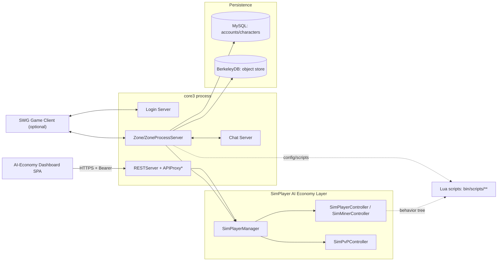

# SWGSolo (Core3) Architecture Documentation

## 1. How to Read This Document

**SWGSolo** is a heavily-modified fork of **Core3**, SWGEmu's C++ server emulator for *Star
Wars Galaxies* (Pre-CU). Audience: an AI coding agent (the project's primary collaborator)
starting without context; `TRIP-1-plan` / `TRIP-2-implement` require reading it. §2-11 are
inherited engine background; §12-13 cover this fork's AI Economy (SimPlayers, PlayerBots) and
AI PvP / Jedi layers, where new plans almost always land.

## 2. Overview

Core3 serves a 2003-era MMO: zoned persistent world, scripted NPCs, crafting/resource economy,
combat and a Lua quest layer, over SWG's binary protocol. This fork (`TrigsC/SWGSolo`, tracking
`swgemu/Core3` as `upstream`) turns it into a **single-player-capable AI-driven economy
sandbox**: hundreds of autonomous NPCs gather, craft, fight and rank up so the world stays alive
with no humans online. New behavior is **simulation-only by default**; the one approved
exception is the P.10 PlayerBot parity line (§12, "Simulation-only policy").

## 3. Technology Stack

- **Language**: C++14 (core), Lua 5.x (logic/config), some Go (`idlc-go`, IDL compiler rewrite).
- **Build**: CMake 3.7+ + Ninja, Clang ≥16 (preferred) or GCC ≥5.4, `ccache`, 64-bit only.
- **Persistence**: MySQL/MariaDB (`libmariadb-dev`) for accounts/characters; Berkeley DB
  (`libdb5.3`) object store for distributed objects; local `navmesh.db`.
- **Networking**: custom SWG protocol (login/zone/ping/chat) over UDP/TCP; `libcpprest` powers
  the HTTPS `RESTServer` (Bearer token, TCP 44443) for the dashboard.
- **Testing**: GoogleTest/GoogleMock (`MMOCoreORB/utils/googletest-release-1.13.0`) compiled
  into the server binary (see Testing Strategy).
- **Container**: Docker (Debian bookworm) is the only supported dev/build/run environment (§6).
- **Dashboard frontend**: static 3-file SPA (HTML/CSS/vanilla JS) in
  `MMOCoreORB/bin/web/aieconomy-dashboard/`, no framework, no build step.

## 4. Project Structure

```
workspace/Core3/                          # git repo root (branch: miner-ai; remotes: origin=TrigsC/SWGSolo, upstream=swgemu/Core3)
├── docs/                                 # design docs + TRIP docs (1-plans, 2-changelog, 3-code-review, 4-unit-tests, 5-tuto)
├── docker/                               # Dockerfile, compose, build.sh/run.sh — the dev environment
├── linux/, wsl2/                         # native bootstrap scripts, unused by this fork
└── MMOCoreORB/                           # the server source tree
    ├── CMakeLists.txt
    ├── src/
    │   ├── main.cpp, CoreProcess.h       # process entry point
    │   ├── server/
    │   │   ├── zone/                     # THE GAME (§8): objects/ (entity types), managers/ (~45 singletons), Zone.idl
    │   │   ├── login/, ping/, status/, chat/
    │   │   ├── web/                      # RESTServer + APIProxy* (§11)
    │   │   ├── db/                       # MySqlDatabase / MantisDatabase (BDB object store)
    │   │   └── metrics/
    │   ├── templates/                    # static game-data schema (.iff-derived)
    │   ├── terrain/, pathfinding/        # heightmap terrain + Recast navmesh
    │   ├── tre3/, client/                # client asset/protocol glue
    │   ├── autogen/                      # GENERATED from .idl — never hand-edit
    │   └── tests/                        # GoogleTest sources (core3tests, linked into core3)
    ├── utils/engine3/                    # submodule: ORB, Lua bindings, Locker/Reference, net — never modified
    ├── bin/                              # RUNTIME tree (built `core3` lands here)
    │   ├── conf/                         # config-local.lua, config.lua, adminusers.lst, ssl certs
    │   ├── scripts/                      # ALL LUA — managers/, ai/, screenplays/, commands/, object/, mobile/, skills/
    │   ├── web/aieconomy-dashboard/      # dashboard SPA
    │   └── databases/, navmeshes/, log/
    └── sql/                              # schema migrations
idlc-go/                                  # Go IDL compiler reimplementation
```

## 5. Core Architecture Principles

- **IDL-generated distributed objects** — entities are declared in `.idl` and generated into
  `src/autogen/` (§9).
- **Reference-counted, lock-guarded objects** — `Reference<T>`/`ManagedReference<T>` plus
  explicit `Locker` discipline. **#1 stability rule (owner-stated): match the nearest existing
  caller's lock choreography exactly.** A mismatched lock/mount sequence caused the P.4.4
  vehicle-mount orphan regression.
- **Manager-per-subsystem** — singletons under `server/zone/managers/*` (`CombatManager`,
  `ResourceManager`, `JediManager`, `AiEconomyManager`, ...), each owning its state with C++ and
  Lua surfaces.
- **C++ core, Lua behavior/config** — behavior trees, screenplays, commands and tunables live in
  Lua under `bin/scripts/` (§10); new tunables default to a Lua config entry, not a constant.
- **Docker-only incremental dev loop** (§6).

## 6. Build System & Toolchain

Everything runs in the `swgemu_server` container. The host mount
`/srv/games/swgemu-core3/workspace` is **unreliable**: verify with a real `ls`/`cat`, else
`docker cp` in/out and `chown 44400:44400` (the in-container `swgemu` user).

```bash
# Build (incremental)
docker exec -u swgemu -e TERM=xterm swgemu_server bash -lc 'build'
#   TERM=xterm is REQUIRED (the script calls `clear`).
#   `build clean` full rebuild | `build nocache` clears ccache | `build asan` RelWithDebInfo+ASan

# Run / restart the live server (~40-50s startup)
/home/swgemu/bin/run
#   RESTARTING IS THE OWNER'S CALL. Sole exception: explicit /TRIP-verify, whose guarded script
#   may disconnect test players and restart after a green build (GDB shutdown first, then
#   force-kill only the exact core3 process).
```

CMake options: `BUILD_IDL`, `COMPILE_TESTS`, `ENABLE_ASAN`/`TSAN`/`UBSAN`. Debug builds are
`-Werror`-strict — **build warning-clean before handing work back**.

## 7. Configuration

- **`bin/conf/config-local.lua`** — runtime config (DB credentials, ports, toggles), overrides
  `config.lua`; never committed with secrets. **`bin/conf/features.lua`** — global feature flags.
- **`bin/scripts/managers/*.lua`** — per-manager tunables; `sim_player_manager.lua` holds every
  AI-economy knob and is where new features expose owner-tunable, default-off gates.
  **The running server re-reads it from disk continuously**: a syntax error is hit within
  seconds (previous config kept), so `luac -p` any edit immediately.
- Compiled constants are the exception; prefer Lua so behavior tunes without a rebuild.

`sim_player_manager.lua` blocks by release (all default-off unless noted):

| Release | Blocks / gates |
|---|---|
| P.4-P.9 | demand thresholds, `enableStationTravel`, `vehicleConfig.enableVehicleMechanics`, recovery `dryRun`, `ticketCollectorTravel` (+`interiorContainmentMarginMeters`), `cellNavDiag.{enabled,logging}` |
| F_0.8.0/0.8.1 | `structureTraversal` (`enabled`, `logging`, `hollowEscalation*`, `farSideEgress`, `hollowDoorEgress.*`, `zeroClip.{enforce,rejectionCap,walkableConfirm,walkableToleranceRatio}`) + `structureTraversalTest` matrix |
| F_0.9.0/0.9.1 | `playerBotProgression` (`enabled`, `flushIntervalSeconds`, `reaper.*`, `awardKillXp`, `killXpRate` 1.0 = parity) + `playerBotParityTest` (matrix, `killTargetTemplate`) |
| F_0.9.5 | `trainingEnabled`, `trainingMaxPerTick`, `trainingSweepBatch`, `trainingPlans` (`name`, `goalSkill`, `profession`, `weaponTemplate`, `weaponType`); `pveConfig.novice` (`enabled`, `retireLegacyHunters`, `bodyTemplate`, distribution, `bodyHam` 800 = starting player) |
| F_0.9.6 | plan `goalSkills`; `earlyGameEnabled` + `earlyGame` (`realWeaponDamage`, XP-type loadouts, grind anchors, level band/TTK target selection, `avoidGroupAggroTargets`, spawner roaming, `unreachableSkip*`, survival fractions, `deathAvoid*`, `combatTelemetry`, `movementTelemetry`); top-level `combatDiag` (`simcombat.log`) |
| F_0.9.7 | `combatAbilitiesEnabled` + `combatAbilities` (`specialAttackChancePercent`, `preferFreeStateAbilities`, `hamReserveFraction`, `freeStateRetrySeconds`, `excludedCommands` = taunt/warcry1/warcry2, `usageHistorySize`, later `avoidAreaAttacksNearLair`) |
| F_0.9.8/8b | plan `linePriority` / `parallelXpStreams` (absent = old behavior); `missionBoard.{lairEngagementHold, lairRetargetIntervalMs, waveDisengage, waveDeaggro, travelCombat, travelRestHamPct, travelMaxFleeLegs, attackerRecognition, lairRetreatDefense, stockPlacement, revealRelocateEnabled, lairRevealDeferMaxCycles}`; `pveConfig.marketDispatch.progressionDispatch` (`enabled`, `grindFallback`, `grindFallbackMinutes` 5..240); `deferredXpTypes` = medical, crafting_medicine_general, crafting_general. **Committed ON (owner, 2026-10-13)** — the first default-off exception; the progression master gates and `novice` stay off. |
| F_0.9.2 (v0.9.9) | `awardMissionCredits`, `buffPayment` (`enabled`, `doctorFeeCredits`), `ledgerRetentionDays` (0 = forever) |
| F_0.9.3 (v0.9.10) | `lootEnabled` + `loot` (`maxItemsPerBot` 80, `arriveMeters`, `maxDetourMeters` 64, `claimTtlSeconds`, `maxClaimsPerBot`, `stepTimeoutSeconds`) |
| F_0.9.9 (v0.9.11) | `bazaarSell`, `bazaarSaleBacklogMax`, `bazaar` (`markup` 3.0, `minPrice`, listing caps, `listingDurationHours`, `visitCooldownMinutes`, `maxDetourMeters`, sweep cadence, `drainOnDisable`) |
| F_0.9.10 (v0.9.12) | `bazaarBuy`, `bazaar.buy` (`reserveCredits` 5,000, `maxPurchasesPerVisit`, `maxPendingPerBot`, `candidateScanLimit`, `maxObjectLoadsPerVisit`, `executeTimeoutSeconds`); per-plan `buyList` (`template`, `quantity` 1..5, `maxPrice`; ≤8, shipped empty) |
| F_0.9.12 (v0.9.13) | `weaponLoadout`, `loadout` (`minUpgradePercent` 10, `fullSweepMinutes`, `bazaarUpgrades`, `upgradeSpendFraction` 0.5, `upgradeScanIntervalMinutes`, `maxUpgradeLoadsPerVisit`) |
| F_0.9.13 (v0.9.14) | `armorLoadout`, `loadout.armor` (`minUpgradePercent`, `assumedArmorPiercing`, `damageTypeWeights`, `bodyRaces` `{body, race}` pairs, `bazaarUpgrades`, `upgradeSpendFraction`, `maxUpgradeLoadsPerVisit`, `bodyHamBaseline`) |
| F_0.9.14 (v0.9.15) | `consumablesEnabled`, `consumables` (`bazaarRestock`, `minDoses` 10, `minRecheckSeconds`, `noDoseRetrySeconds`, `restockScanIntervalMinutes`, `maxRestockLoadsPerVisit`, `restockSpendFraction`, `items` = `{template, maxPricePerDose, minDoses?}`: Vasarian brandy, pikatta pie, crispic) |
| F_0.9.15 (v0.9.16) | `groupingEnabled`, `grouping` (`roomName` LFB, offer TTL 180 s, `defaultReplies` 2, `maxRepliesCap`, reply delays/gap, `availabilityChancePercent`, request cooldown and room rate, `maxGroupedBots` 10, `maxBotsPerLeader` 9, join delay, `followMinMeters`/`followMaxMeters`, `repathMoveMeters` 3, `followTickMs` 750, `routeDistanceMeters`, `maxReplansPer10Min`, `assistRadiusMeters`, `leaderOfflineGraceSeconds`, `vocabulary` roles/gear/tiers/status/leave, `lines`) |

The sim layer alone restores roster PlayerBot weapon-template stats after shared AI weapon-stat
setup; synthetic harness identities stay outside that path.

---

## 8. Game World / Server Architecture

- **Process model**: one `core3` binary hosts the zone server(s) plus login, ping, status and
  chat servers, wired by `main.cpp`/`CoreProcess`.
- **Zones** (`Zone.idl`, `GroundZone`, `SpaceZone`) are per-planet simulation containers ticked
  by `ZoneProcessServer`.
- **Objects**: `SceneObject` → `TangibleObject`/`IntangibleObject` → `CreatureObject` →
  `AiAgent` (NPCs) / players / SimPlayers (§12). Static data comes from `templates/`.
- **Pathfinding**: `terrain/` + `pathfinding/recast`. **Only cities/POIs are navmeshed**; in open
  wilderness (where resources spawn) `findPath` degrades to a 2-node "direct fallback". This is
  the root constraint behind the overland and station-travel work in §12.
- **Persistence**: MySQL rows for accounts/characters; BDB object store (`server/db`) for the
  object graph, keyed by ORB object IDs.

## 9. Distributed Object / IDL Codegen System

1. A `.idl` file (Java-like DSL) declares fields, methods and annotations (`@json`, `@read`,
   `@dirty`, ...).
2. The IDL compiler (`BUILD_IDL`; Go rewrite in `idlc-go/`) generates `src/autogen/`: interface,
   `*Implementation` skeleton (hand logic in a co-located `*Implementation.cpp`), RMI
   stub/adapter, GoogleMock doubles.
3. Hold objects via `Reference`/`ManagedReference`, take the `Locker` before mutating, and copy
   the nearest existing caller's lock sequence.
4. **Never hand-edit `src/autogen/`** — it is gitignored and regenerated at build, so an additive
   `.idl` method costs one committed line (F_0.9.1 added `PlayerManager::getExperienceMultiplier()`
   this way). The cost is build fan-out: that one line took an incremental build from 17 to 89
   targets.

## 10. Lua Scripting Layer

- Bridged by engine3 `engine/lua/*` (`LuaObject`, `LuaFunction`, exception translation).
- `bin/scripts/managers/` (config + callbacks), `ai/` (behavior trees), `screenplays/`,
  `commands/`, `object/`, `mobile/`, `skills/`.
- **Behavior trees vs C++ controllers**: `simMiner.lua` is a deliberate no-op so
  `SimPlayerController` is the sole mover (no dual-driver fight with `GeneratePatrol`).
  `simHunter.lua`/`simPvp.lua` override **only** the IDLE slot: the controller drives movement,
  the stock tree drives combat (call `activateAiBehavior(true)` on engage to wake it).
- **`LuaObject` field reads are stack-relative.** `getBooleanField` and siblings read the table
  on top of the stack (`lua_gettable(L, -2)`). A parent read while a child table from
  `getObjectField` is pushed silently reads the child and returns the default. Read parent
  fields before opening a child, or after popping it (F_0.9.13: `armorLoadout = true` parsed as
  false). Presence detection = read a field twice with two defaults; never poke the stack with
  `lua_getfield`.
- **Safe Lua↔C++ wrapping (crash class).** `AiAgent(pObj)`/`LuaAiAgent(pObj)` `dynamic_cast`;
  in debug (`DYNAMIC_CAST_LUAOBJECTS`) a wrong type fires `E3_ASSERT` → `abort()`, which
  `pcall`/`safeCall` cannot catch (release builds: UB). Gate first with a cast-free predicate
  (`SceneObject(pObj):isCreatureObject()` / `:isAiAgent()`), and mirror agent-only reads onto
  `LuaCreatureObject` via `CreatureObject::asAiAgent()` (e.g. `LuaCreatureObject::isSimPlayerBot`,
  F_0.7.2 SIGABRT fix).

## 11. Web/REST Layer (AI-Economy Dashboard)

- **`src/server/web/RESTServer`**: HTTPS (`libcpprest`), Bearer-gated, port 44443.
- **`APIProxy*Manager`** (`AiEconomy`, `Player`, `Guild`, `Statistics`, `Config`, `Chat`,
  `Object`): thin read-mostly per-manager facades — the pattern for exposing new state.
- **`SimPlayerManager`** assembles the JSON sections (`minerActivity`, `coveragePlanner`,
  `minerRecovery`, `pathValidationDiagnostics`, `simulatedAcquisition`, `vehicleMechanics`,
  `stationTravel`, `pveActivity`, `playerBotProgression`, ...).
- **Per-object detail endpoints** keep the poll small: `GET /v1/aieconomy/playerbot/(\d+)/`
  (`handlePlayerBotGET` → `getPlayerBotInspectJson`, F_0.9.7), built on demand, 404 for an
  unknown identity — copy it for any "click a row for detail" surface.
- **Frontend** `bin/web/aieconomy-dashboard/` (`index.html`/`app.js`/`styles.css`): hash-routed
  (`#/command`, `#/warfront`, `#/wilds`, ...), deployed by copying files (no restart). Bot names
  open a detail drawer fed by the endpoint above.
- The live endpoint is ground truth for any AI-economy claim:
  `curl -sk https://127.0.0.1:44443/v1/aieconomy/dashboard/ -H "Authorization: Bearer <token>"`

## 12. AI Economy Simulation Layer (SimPlayers) — active development focus

Layered on the stock `AiAgent`/`CreatureObject` hierarchy. Living design docs:
`docs/ai-miner-navigation-design.md` (P.4), `docs/ai-cell-navigation-design.md`,
`docs/ai-pve-playerbot-design.md`, `docs/1-plans/ROADMAP_p10-playerbot-parity.md`.

### Core classes

- **`server/zone/objects/creature/simplayer/SimPlayerManager.{h,cpp}`** — the "economy brain":
  roster, demand/supply simulation, resource targeting, cross-planet coverage, the PlayerBot
  stores, and all dashboard JSON (§11). The largest, most-touched file.
- **`SimPlayerController.{h,cpp}`** — per-NPC movement base (`SimMinerController` for gatherers):
  path/sample lifecycle, stuck-watchdog (bounded re-path → `onPathFailed`), activation trust
  (`isActivationTrustAcceptable()` = `verifiedPath` or overland `directOverland`).
- **`SimPvPController`** (§13) and **`SimHunterController`** (PvE, below) are its siblings.

### Movement and cell navigation (P.4-P.9)

- **Cell-aware `moveTo`** (P.6.5b): optional target cell; world position for distance math,
  cell-local for the path request; path-node cells survive into `PatrolPoint`s. Outdoor callers
  (all miners) are unaffected. **`findNextPosition` assumes one coordinate space per comparison**
  — keep world and cell-local forms separate (`tuto_0.4.11.md`).
- **Cell-nav stack** (F_0.4.7-F_0.4.11): cell entry adopts the cell on `findNextPosition`'s
  duplicate-skip branch (no teleport-into-wall); cell egress
  (`beginCellEgressIfNeeded`) portal-follows to an exterior then resumes; multi-door starports use
  `BuildingObject::getNearestExteriorPortalPoint`; gated `ticketCollectorTravel` walks to the
  collector in the enclosed hollow (`resolveStarportInteriorWaypoint`, tri-state, bounded
  horizontal containment margin) with bounded retries, outdoor recovery and an idempotent PvP
  arrival OID barrier. `CellNavDiagLog` → `bin/log/cellnav.log` (gate `cellNavDiag.logging`).
- **Structure traversal (P.9 / F_0.8.0)** — explicit state machine on `SimPlayerController`:
  `StructureTraversalPhase` (`Idle→ApproachDoor→InteriorRoute→Egress→Reentry→CombatPaused→Resuming`)
  with a `traversalGeneration` **separate from** the movement generation, so combat can cancel a
  path task without cancelling traversal intent. Bounded hollow escalation rescues bots stranded
  in a starport hollow. **D2b far-side egress**: from inside a starport the pathfinder routes to
  the far door via the *nearest* portal back into the hollow — a path that **succeeds while making
  no progress**, invisible to the failure-only repair ladder. `acceptFoundPath` rejects it and
  retargets to the nearest reachable non-hollow exit cell, exempting destinations in the hollow
  (multi-hop transit lands on the pad). **Never force a bot out of a hollow that is its
  destination.**
- **Adoption (F_0.8.1)** — machinery is not adoption: `enterStructure()` once had only the
  harness as caller. Rule: a cell-bearing destination is a building entry and goes through
  `enterStructure`, not bare `moveTo`. Migrated: `SimHunterController` (buff providers),
  `SimPvPController` (collectors, starport waypoints), guarded on a non-null cell (a hollow is a
  null cell and stays outdoor); where the legacy call was `moveTo`, the guard also tests the gate,
  since `enterStructure`'s null-cell fallthrough calls `moveToInterior`. **Miners are not
  migrated** (station travel lands them outdoors). `acceptFoundPath` is a non-virtual template
  method (invariants + `virtual acceptFoundPathHook`). **`exitStructure` is NOT adopted**:
  production bots leave via the legacy egress ladder (`F_0.8.2_traversal-egress-adoption.plan.md`).
- **Test-oracle vs production telemetry (F_0.8.1)** — harnesses assert on **per-agent** tallies
  (monotonic `std::atomic` on `SimPlayerController`, not reset by `clearStructureTraversalState`),
  never on global dashboard aggregates, which any world bot can move. A destroyed body's counters
  fold into a per-slot carry in `destroyStructureTraversalTestBot`, under the agent lock.
- **Post-lock lifecycle recheck (F_0.8.1)** — any pre-lock guard (e.g. `agent->getZone()` in
  `checkArrival`) needs the same check after `Locker locker(agent)`: another thread may have
  destroyed the agent under that lock meanwhile.
- **Harness single-writer pattern** — the 26-scenario `structureTraversalTest` matrix (AI
  `simTraversalTest.lua`) holds its cursor under `structureTraversalTestMutex` per invocation but
  schedules tasks **outside** it: notify hooks take that mutex from threads holding agent locks
  (harnessMutex → agentLock vs agentLock → harnessMutex = ABBA). Log:
  `StructureTraversalDiagLog` → `bin/log/structuretraversal.log`.
- **Zero-clip (D7)**, observe + enforce, default-off (~19 ms p95/path): the probe
  (`probeEmittedPathClearance`) runs on the pathfinding worker before delivery; results are
  explicit (`clear`/`would_block`/`skipped`/`truncated`/`error`), worst-evidence-first.
  Enforcement re-asks up to `zeroClip.rejectionCap` then walks the route; it fails **open** (a
  mover that cannot see must still move), while harness oracles fail **closed**. Off-thread
  snapshots must be `SortedVector<ManagedReference<TreeEntry*> >`, never raw
  `InRangeObjectsVector`. Chord rays through stairs/bridge decks hit solid mass;
  `zeroClip.walkableConfirm` checks flagged chords against the navmesh. `getRecastPath`'s
  `float& len` is **not** a length (relative comparator only).
- **Shipped state (v0.8.2, owner)**: traversal master gate, `zeroClip.exitSetEnabled`,
  `farSideEgress`, `hollowEscalationEnabled`, `hollowDoorEgress.*`, `crossBuildingStaging` are ON;
  zero-clip probe/enforce, all traversal/cell-nav logging and the harness are OFF (no `ST_PHASE`
  traces by default).

### PvE hunters (`SimHunterController`, P.8)

- **Loop**: market-driven mission hunt (travel → terminal → held offer → real lair → pull → kill →
  harvest) closing the crafter→hunter demand loop; also owns the gated cross-planet buff trip.
  `SimPlayerManager` owns offers, dispatch and routes. Combat is **real**
  (`CombatManager::startCombat`); bodies spawn `PLAYER | ATTACKABLE`, faction 0, with player-safe
  targeting: the `AiAgentImplementation::isAttackableBy` mirror is consulted by `startCombat` and
  `getAreaTargets`, so no AoE splash onto players. Navmesh in cities, overland in the wild
  (`usesNavmeshHybridMovement()`, base false). Default body `death_watch_wraith` + `rifle_t21`.
- **Two tick threads, single writer**: `onTick` (arrival) and `runActiveTick`
  (`SimHunterActiveTickTask`) run on independent pool threads; `runActiveTick` owns combat-target
  state, `onTick` only self-defends on travel legs. Defender reads snapshot under the hunter lock
  (`add`/`removeDefender` are `@preLocked`). `activeTickGeneration` is atomic latest-wins,
  `tickRunning` a non-blocking single-flight guard.
- **Terminal-visit epoch (F_0.5.0)**: `openTerminalVisit` / `pveTerminalVisitEpoch` captured at
  board open and rechecked at commit, so a late offer set for a finished order or drained body is
  discarded. An empty board retries `offerMaxAttempts`×`offerRetrySeconds`.
- **Demand-pressure dispatch**: an order issues only while a family's `signalUnits > 0` (supply
  below `effectiveCeiling`, `familyAllocationCeiling{Units,Fraction}`; fraction 1.0 — a lower cap
  silently strands the roster). F_0.6.0: hunters supply **hide, bone and meat**; one kill credits
  all three in `recordPveHunterHarvest` (≥3 units each); accept reserves all three
  (`computeReservedInboundByProfileFamily`) with an intra-pass signal decrement. Known debt:
  `consumeReservation` does not drain `familySupply` in-session, so families re-saturate until a
  consumer phase exists.
- **F_0.9.8b progression-first dispatch** (`progressionDispatch.enabled`): a bot whose whole
  training plan is incomplete (`SimBotActivityDecision::templateComplete`; deferred XP types do not
  block) is dispatched by `runPveProgressionDispatchPass` before the extraction loop. Candidates are
  lairs combat will fight (`SimBotDispatchPolicy::isLairFightable` = the pack rule,
  `hasPackMobile`; solo assumed) in the **grind tier** window (`getPlayerBotGrindTier`: weapon
  difficulty tier, not combat level), ranked non-pack → XP fit → demand → same planet. The order
  pins the lair (`pinnedLairTemplate`, `dispatchLevel`, `avoidPacks`), honoured by
  `selectPveBotMissionLairSpawn`. Nothing fightable → grind for `grindFallbackMinutes`
  (`progressionGrindFallbackUntilMs`, read by `scorePlayerBotActivity`).
- **F_0.9.8c travel combat** (`missionBoard.travelCombat`, `travelRestHamPct`): on every overland
  mission leg a `SimBotTravelCombat` sub-mode (MOVE/FLEE/REST, owned by `runActiveTick`) flees
  **toward the mission** (veer if the attacker is ahead, sideways near the destination) and rests
  to `resumeHamPct`. Base hooks (default old behavior): `allowsMovementInCombat()`
  (`moveToWithOrigin`, `onPathFound`, `checkArrival`) and `isMovementHeld()`. Flee arrivals/path
  failures route to the tick, never to `LAIR_REACHED`. A mop-up hold (self-release 180 s) stops
  walking while a creature is aimed at the bot. `missionBoard.attackerRecognition`:
  `selectActiveCombatAttacker` also takes threat-map creatures in combat and aimed at the bot.
- **Real buffs (P.8.6, `realBuffs.enabled`)**: when a tracked buff is missing or near expiry, the
  hunter visits its home-city med center/cantina and is buffed by real Doctor/Musician/Dancer NPCs
  (`PlayerManager::startWatch`/`startListen`; doctor chat driven via `ScreenPlayTask`, since bot
  chat cannot reach the player-only `SPATIALCHATSENT` observer). `realBuffs.fallbackBuffs` covers
  unreachable providers.
- **Provider anchors are search anchors, not destinations (v0.8.2)**: `resolvePvpCityLocations`
  publishes `hangout`/`medCenter` exterior points; the move target is the provider NPC's own
  cell-local position. On a miss `getPveHomeLocations` silently collapses `medCenter` to the pad,
  so the scan now honours `medCenterManual`, else scans from pad **and** hangout at
  `medCenterScanRadiusMeters` (900 m) (Theed's pad is 561 m from its cantina).
  `realBuffs.providerResolveState` is `doctor || musician || dancer` — "resolved" does not mean the
  doctor resolved.
- **Cross-building cell entry is not pathfindable at range (v0.8.2)**: `findPath` to a cell in
  ANOTHER building from an ordinary outdoor point fails deterministically (Theed: 22/23, ~100 ms),
  positional, not stateful or target-specific; overland movement there works. Provider approaches
  stage through the target building's exterior anchor (gates
  `isStructureTraversalFeatureEnabled()` + `realBuffs.crossBuildingStaging`).

### PlayerBot parity line (P.10)

- **PlayerBot progression store (P.10a / F_0.9.0)** — the durable home for
  player-parity state, and the first piece of the P.10 line. XP by type,
  bank/cash credits, skill points and trained skills live in three MySQL tables
  (`simbot_progression`, `simbot_experience`, `simbot_skills`, schema 1010-1012)
  keyed by **roster identity id**, never by object ID and never on `AiAgent` —
  a PlayerBot body has no `PlayerObject` ghost and is destroyed and rebuilt on
  death, so nothing durable can live on it, and a record reachable from an
  object would repeat the `simPlayerBot` sticky-flag leak. Three invariants
  carry the design: **one creation function**
  (`ensurePlayerBotProgressionRecord`, which refuses any id absent from the
  loaded roster) called at roster mint and again from reconciliation as an
  idempotent repair, because MyISAM cannot make the identity and record INSERTs
  atomic; **award-requires-record** (a missing record is counted and skipped,
  never created — so a leaked flag on a wild creature resolves to identity 0 and
  is rejected); and **one SQL lane** — every store query runs on the PvE
  maintenance task, with the harness enqueueing `PlayerBotProgressionRequest`
  entries rather than issuing SQL itself. The flush **atomically swaps** its
  dirty batch before I/O and merges failures back, so an award landing during
  SQL is never dropped (the roster's clear-after-write shape is deliberately not
  copied), and `dbAvailable` recovers through a bounded `SELECT 1` re-probe.
  `pveMaintenanceTaskScheduled` became a `scheduled/running/rerunPending` state
  machine so `kickPveMaintenanceNow()` can pull the lane forward without ever
  running two bodies; the successor is scheduled one interval from **body
  entry**, preserving the previous cadence. A corollary the harness proved the
  hard way: anything a test arms for *its own* lane operation must travel with
  that request, not sit in shared state. The flush fault knobs were global and
  the routine end-of-tick flush could consume one armed for the harness's
  `FlushNow`, which both broke the scenario and made it flaky; faults are now
  parameters of `flushPlayerBotProgressionStore`. The lane publishes
  `maintenance.{ticksTotal,kicksRequested,kicksImmediate,kicksDeferred,requestMaxWaitMs}`
  so a request that waits a full interval is attributable from one dashboard
  read instead of log archaeology. Verification vehicle: the
  18-scenario `playerBotParityTest` matrix (`sim_player_manager.lua`, AI
  template `bin/scripts/ai/simParityTest.lua`, controller
  `SimParityTestController`), including a durable **two-boot restart probe**
  whose phase-A verdict file is written only after every other scenario passes
  and is read fail-closed. Dashboard section: `playerBotProgression`, carrying
  `orphanRecords` and `rosterWithoutRecord` so a leak is visible rather than
  silent. The award API ships with **no production caller** — adoption is
  F_0.9.1's job, per the F_0.8.1 rule that adoption is a separate step.
- **Kill XP for roster PlayerBots (P.10b / F_0.9.1)** — the first production
  caller of that award API, and the first real economy mutation in the line.
  The hook lives **inside** `PlayerManagerImplementation::disseminateExperience`
  (after `baseXp` is derived), not at the `CreatureManagerImplementation.cpp`
  call site the roadmap originally sketched: `disseminateExperience` has two
  callers - single-creature death and `DisseminateExperienceTask` for lairs - so
  hooking inside covers both with one branch and reuses the already-computed
  `baseXp`/`totalDamage`/`gcwBonus`, and the P.7.4b FRS block proves the
  posture. No combat-side change was needed: `ThreatMap::addDamage` already
  records **every** attacker, AiAgents included, keyed by that attacker's weapon
  `getXpType()`, so bot hunters were always in the victim's threat map.
  `disseminateExperience` runs with the corpse **already locked** (the FRS block
  cross-locks), so the branch takes **no object lock and no mutex**: it copies a
  plain POD (`PlayerBotKillXpEvent` - per-attacker OID, damage-by-type and
  group/GCW multipliers, plus an event-level global multiplier) and hands it to
  a deferred `SimPlayerBotKillXpTask`, which resolves identities under
  `pveMutex` and writes under `progressionMutex`. Capturing a
  `ManagedReference` to the corpse is deliberately avoided. The cheap
  synchronous pre-filter uses `AiAgent::getSimPlayerBot()` **only as a cost
  filter, never as authority** - that is the flag that leaked onto wild
  creatures (fixed in `d38877020c`), and both failure modes are safe: a stale
  true costs one task that resolves nothing, a stale false costs one kill's XP.
  Authority remains `resolvePlayerBotIdentity`. The formula mirrors the player
  path exactly, including its **rounding**: the direct path truncates twice
  (once at `awardExperience`'s `int amount` boundary, once inside after
  `globalExpMultiplier`) while `combat_general` truncates once because
  `combatXp` is already a `uint32`; `combatXp` accumulates per iteration,
  excludes `jedi_general`, and includes `dotDMG` (which earns no row of its
  own). Bot level comes from the identity's `skillTier`, **never** the body
  template's level - a wraith-templated body would otherwise cap at 178x300.
  The lifetime ceiling moved **inside** `grantPlayerBotExperience` (mirroring
  `PlayerObjectImplementation::addExperience:708-717`, defaults from the new
  `SkillManager::getDefaultXpLimit`, 2000 fallback, `prestige_` uncapped) so
  every future XP source inherits it; a type already at its ceiling returns
  `false` without a rejection counter, since the caller passed a valid amount
  and the store simply had no room. Gate and rate are **call parameters**
  (`PlayerBotKillXpParams`), not reads of global state, so the harness can
  exercise the real gate and rate branches without mutating configuration that
  concurrent production kills would see. Scenarios 19-28 extend the matrix;
  scenario 28 is the call-site proof - a harness bot kills a spawned
  `dwarf_nuna` with real rifle combat, which works with **no controller
  change** because harness and hunter identities share one body path (rifle,
  faction 0, `ATTACKABLE`) and `simParityTest` overrides only `IDLE`, leaving
  the combat sockets live. Dashboard: `playerBotProgression.killXp` plus the
  now-real `gates.awardKillXp`. **A new addressing mode inherits the async
  lifetime of the ops it is used with** — the one defect live verification
  found: `deleteIdentity` re-resolves its identity on *every* poll, so pruning
  the new named ref when the request completed made the very poll that observed
  completion fail. Positional addressing never hit it because that handler never
  touched the positional vector. Harness reference maps are scenario-scoped and
  are cleared wholesale by the cleanup pass; nothing may prune them mid-flight.
  A second, cheaper lesson: `LuaObject` presence-detection is done by reading a
  field twice with two different defaults (absent ⇒ the reads disagree), never
  by poking the Lua stack with `lua_getfield`, which would bake in an internal
  convention about where `LuaObject` keeps its table.
- **Skill training and novice PlayerBots (P.10f / F_0.9.5)** — turns F_0.9.1's
  XP into progression, and mints roster bots as novices instead of inheriting a
  level-178 combat mob. Four architectural points:
  **(1) Derived spend makes training atomic.** `simbot_experience` means
  *lifetime earned* — already what F_0.9.1 wrote, since `grantPlayerBotExperience`
  only ever adds — so available XP is `earned − Σ getXpCost()` over trained boxes
  of that type and `skill_points_spent` is recomputed from `simbot_skills` rather
  than stored. Training therefore mutates exactly **one** durable row (an INSERT
  into `simbot_skills`), which is atomic under MyISAM and self-healing at boot,
  so no write-ahead journal is needed; the journal remains the right tool for
  F_0.9.6's bazaar, where value is human-visible and multi-party.
  **(2) The same skill mod is treated oppositely in two places, on purpose.**
  Combat tier reproduces `PlayerManagerImplementation::calculatePlayerLevel`
  (`:4655-4679`) as `min(25, private_<weapon>_combat_difficulty/100 + 1)` from
  **trained deltas only**, because a real player has no template statistic behind
  that mod and adding one would exceed player parity. The body overlay
  (`applyProgressionToBody`) **must** add `npcTemplate->getStatistic(mod)`,
  because `AiAgentImplementation::getSkillMod` (`:624-664`) returns the
  creature-list value whenever nonzero and only then consults the template — a
  bare delta would make a trained bot *weaker* than an untrained one. Unifying
  these two rules is a bug in either direction.
  **(3) The overlay is a SKILLBOX-only full reconcile.**
  `removeAllSkillModsOfType(SKILLBOX, false)` then one `addSkillMod` per touched
  mod, which is idempotent with no per-body bookkeeping and identical on respawn
  and mid-life training. It is safe because `SKILLBOX` is written only by
  `SkillManager::awardSkill` (`:380`) and cleared by `surrenderSkill` (`:582`,
  `:726`) — ghost-gated player paths a PlayerBot body never reaches. The
  `TEMPLATE` group is left to the Jedi archetype path so neither double-counts.
  **(4) `pveMaxHunters` was a spawn-batch cap, not a population cap, and the
  governor had no notion of ownership.** The old `governPvePopulation` skipped
  identities that already had a live body *before* counting them against the
  cap, so adding a novice to a full roster produced a seventh body rather than a
  replacement. It is now a desired-active-set reconciler: compute the set, drain
  at most one out-of-set body per tick via the `drainSimPresenceBodies`
  choreography (`:12523-12580`), then spawn at most
  `pveMaxHunters − liveBodyCount` **recounted after the drain**.
  **A governor that only ADDS bodies never has to know which bodies it owns.**
  Introducing a drain made ownership load-bearing, and four review findings in
  this one function all resolved to the same shape — one membership predicate
  written in more than one place, then drifting. The settled model:
  `isGovernorManagedIdentity` (`profession != "harness"`) defines ownership and
  is deliberately **independent of `isPveHuntEligible`**, because eligibility
  reads the runtime-refreshable `pveHuntingProfessions` and tying ownership to it
  would strand live bodies the moment a profession was removed — invisible to the
  drain *and* uncounted against the cap. Eligibility is computed **once** into an
  `eligible` set that both the distribution and general-fill passes filter to, so
  those passes decide **ordering only, never membership**. The same ownership
  predicate governs the drain, the spawn budget and the `assertBodyMaxBound`
  harness assertion, so harness bodies sit outside the production population
  entirely. Retirement is a separate destructive path from the body drain and
  needs **two independently guarded flags** — `pveRetiringIdentityIds` under
  `pveMutex` and `progressionRetiringIds` under `progressionMutex` — because the
  dirty writers live under a different mutex than governance and nesting them is
  forbidden; `progressionDirtyIds` is cleared *before* the row deletes so a flush
  landing mid-teardown cannot resurrect them. Three concurrency/ordering defects
  were caught in review rather than by the compiler, all of the same shape (state
  shared between the PvE task, the PvP config-refresh task and the REST thread):
  `progressionTrainingPlans` was read lock-free; a `...Locked` helper called a
  gate taking `playerBotParityTestMutex` while holding `progressionMutex`,
  inverting the order used everywhere else (the gate is now a parameter evaluated
  before locking); and the per-tick config refresh reset the training sweep
  cursor and pending queue on every PvP maintenance tick, which a derived plan
  signature now suppresses. Gates `playerBotProgression.trainingEnabled`,
  `pveConfig.novice.enabled` and `novice.retireLegacyHunters`, all default-off.
  **Verification lesson worth inheriting**: two of this chunk's defects were
  reachable only when the code *ran under the shipped default-off configuration*
  — a capability gate that checked its own flag ahead of the test override could
  never be exercised at all. Any future P.10 capability gate must place the
  master gate first, the harness override second, and the configured capability
  last (`playerBotProgressionAwardGateEnabled` is the reference shape).
- **Novice early-game grind loop (P.10g / F_0.9.6)** — the first PlayerBot that
  *produces* its own XP rather than consuming XP handed to it. An early-game
  state machine on `SimHunterController`'s `runActiveTick` idle branch
  (`LeaveCity → SelectTarget → Engage → Recover → Train`), gated by
  `playerBotProgression.earlyGameEnabled`. Five points worth inheriting:
  **(1) Server knowledge may inform selection, never the fight.** Targets are
  chosen by a level band around the bot's own tier (`skillTier ± 3`) and a TTK
  window computed from the equipped weapon's real damage and the target's
  *minimum* primary pool — a creature dies when any primary empties — via the new
  side-effect-free `CombatManager::estimateDamageAfterMitigation`. Combat itself
  still goes through `CombatManager::startCombat` with no damage advantage (the
  plan's "no cheat kills" invariant). Engage range is the weapon's own
  `maxRange − 1`; the hunter's 48 m rifle default left an unarmed novice
  "attacking" from 48 m.
  **(2) Every walking branch must schedule its own tick.** `scheduleActiveTick`
  bumps `activeTickGeneration` and supersedes in-flight tasks, so a branch that
  relies on `onArrived`/`onPathFailed` alone simply freezes. Recover and
  scan-pursuit each shipped that bug and each was caught only by a live run.
  **(3) A single-slot memory is a defect when the world can present two of the
  thing.** The Engage path-failure skip held one OID, so two creatures just off
  the city navmesh ping-ponged it for 70 minutes with zero kills and ~15,300
  mover exit-resolve failures. It is now a bounded set
  (`unreachableSkipMaxTargets`, soonest-expiry eviction); when everything nearby
  is skipped the scan comes back empty and the existing rotation re-anchors.
  **(4) Group aggro is PACK-only.** `AiAgent::notifyPackMobs` pulls in PACK
  creatures of the same social group within 20–25 m; HERD and a shared social
  group do **not** assist. `avoidGroupAggroTargets` therefore tests `isPack()`
  alone — the first cut also excluded HERD and left the novice with no eligible
  fauna at all around Mos Eisley.
  **(5) Self-defence judges the whole defender list, repeatedly.**
  `findUnwinnableEarlyGameAttacker` re-checks every live non-bot defender on
  fight entry *and* on every Engage tick, because pack allies join
  asynchronously, and flees the first one outside the band
  (`flee_other_attacker`).
  Bodies: `novice.bodyHam` sets all nine pools (800 = starting player) and clone
  wounds are healed on respawn (`cloneWoundMaxFraction` 0 — the previous
  500-point wound pinned novice HAM at 1); parity-harness bodies are exempt via
  `parityHarnessBody`. Where the fauna is: city `InterestAreaSpawner` screenplays
  place `spawn_egg.iff` objects that spawn a pod within ~10 m, so
  `chooseEarlyGameSpawnerAnchor` finds active eggs by zone query around the home
  city and visits them in rotation, falling back to the ring anchors. Death
  capture: `AiAgentImplementation::notifyObjectDestructionObservers` records the
  killer into `SimEarlyGameDeathLog` (leaf mutex + atomic gate) and
  `onPveHunterDied` is the single finalizer, de-duplicating by body OID and
  recording short-lived death-avoid zones. **Kill XP that silently vanished is
  now counted**: `disseminateExperience` has branches that drop a kill with no
  counter and no log line, so while the kill-XP gate is on a sim bot in the
  victim's threat map bumps `killXp.botKillsSeen` and, on a drop, one of
  `droppedNoDamage`/`droppedNoBaseXp`/`droppedNoSimBotAttacker` plus a
  `SimPveKillXpDropped` line — counted lock-free inline, with identity resolution
  and logging on the same deferred hand-off the award uses. **F_0.9.6-D1** adds
  the allowlist-gated `SimCombatDiagLog` (`bin/log/simcombat.log`,
  `combatDiag.logging`, dashboard `pveActivity.combatDiag`) tracing behaviour-tree
  ticks, attack selection/enqueue and the full kill-XP path — the instrument that
  made these assertions checkable rather than inferred. Live receipt: 43/43 in
  `docs/4-unit-tests/live_p10g-novice-early-game_20260915-225334-p10g-novice-early-game.md`.
- **Skill-derived combat abilities (P.10h / F_0.9.7)** — the first chunk where
  *training changes behaviour*. `buildBodyProgressionSnapshot` derives each roster bot's
  attack list from its trained boxes (`Skill::getAbilities()`, the `commands` column of
  `skills.iff`), keeps only the highest tier per chain (`SimBotAbilityTiers.h`, chain key =
  name minus trailing digits) and installs it on the locked agent as a **transient**
  `skillDerivedAttackMap`, which `setupAttackMaps` uses in place of the mobile template's
  lists; it is cleared in `loadTemplateData` beside `simPlayerBot = false`. Four points
  worth inheriting:
  **(1) Two spellings of the same name.** `skills.iff` is camelCase (`unarmedHit1`), the
  `ObjectController` registry is lower case, and `getQueueCommand` hashes the exact string —
  so the first cut silently derived 3 abilities instead of 23, every hit/lunge/stun landing
  in `excluded:unknown_command`. Normalise before exclusion, lookup **and** installation.
  **(2) NPC specials are free; player specials are not.**
  `CombatManager::applySpecialAttackCost` returns early for every AiAgent, so parity required
  extracting the player arithmetic (`specialAttackHamCostFromInputs`) and paying it for
  skill-derived agents only. The HAM reserve that bounds a special's own spend must test
  **only pools that special spends** — testing all three refused free unarmed specials from a
  merely wounded bot and stopped it attacking entirely.
  **(3) The scorer and the behaviour tree disagree about validity.** The tree runs
  `CheckAttackIsValid` after `SelectAttack` and aborts the tick; the scorer's heuristics do
  not mirror `validateStateAttack` (lunge scores as knockdown, carries POSTUREDOWN), so an
  unfiltered bot re-picked the same invalid special forever. Skill-derived scoring now skips
  what the tree would reject.
  **(4) Policy beats the scorer for control abilities.** A free, non-damaging ability whose
  state the target lacks (Intimidate) is selected **by name** before the special-chance roll,
  with a per-target `freeStateRetrySeconds` back-off; handing that decision to the scorer
  picked a damaging lunge, and checking it only after a missed roll meant a high chance never
  used it at all. Area-aggro commands (`taunt`, `warcry*`) ship excluded — they pull
  bystanders onto a solo grinder.
  Inspection is read-only and **gate-independent**: one snapshot
  (`getPlayerBotInspectJson`) feeds the REST endpoint (§11), the dashboard drawer and
  `/server playerinfo` on a targeted SimBot (previously it showed the admin their own
  record), and with the capability off it still reports what the boxes *would* grant plus a
  `notInstalledReason` — which is what let the live probe find defect (1) before anything was
  enabled. Telemetry: `SimBotAbilityUsageLog` (leaf mutex, bounded ring plus lifetime
  per-command counts and an accumulated target-state mask) and
  `playerBotProgression.combatAbilities` counters. Live receipt: 27/27 in
  `docs/4-unit-tests/live_p10h-skill-abilities_20260916-144849-p10h-skill-abilities.md`;
  one open, unreproduced SIGSEGV is recorded there.
- **Lair tactics and mission graduation (P.10i / F_0.9.8)** — the release where roster
  bots first complete destroy missions. The plan's scorer and tactic sub-state machine were
  never built; the owner's game rules, applied one live observation at a time, replaced
  them (see the plan's "Release scope"). What a future session should inherit:
  **(1) A transition that books no tick is a dead controller.** `SimHunterController` is
  driven by `runActiveTick`, and the phase TTLs are enforced in that same tick. Any path
  that does `setPhase(...)` then a move or scan and returns, trusting an arrival callback,
  can strand the bot for hours with no timeout to rescue it. It happened at lair
  engagement, every `BUFF_UP` exit, each overland leg, and the `HEALING` resume. The guard
  idiom: read `activeTickGeneration` before the transition and `scheduleActiveTick` if it
  is unchanged after (`scheduleActiveTick` always bumps it).
  **(2) The base mover holds a bot that is in combat.** `checkArrival`, `moveTo` and
  `onPathFound` keep it IDLE, and `onPathFound` clears combat state on every accepted path.
  Fleeing or fighting on the run therefore goes through three hunter-only hooks:
  `allowsMovementInCombat`, `isMovementHeld`, `keepsCombatOnPathAccept`.
  **(3) Being attacked is not on the bot's defender list.** `CombatManager::startCombat`
  puts the attacker on the bot's **threat map** only. `selectActiveCombatAttacker` reads
  both, and counts a threat entry only while that creature is in combat and aimed at the
  bot (read under the creature's lock with the hunter's released).
  **(4) Lair waves are spawn-number transitions.** A lair spawns at reveal, at first
  damage and below half condition. Tactics key on the `spawnNumber` change, never on "a mob
  is near", which fired every tick. De-aggro is scoped to that lair's own members.
  **(5) Mission lairs are placed the stock way.** The terminal checks only bounds, water
  and city (`choosePveBotMissionPosition`); `revealPveBotMissionLair` searches on arrival
  (`SimBotMissionPlacement.h`), and a failed search defers, bounded, instead of forcing a
  spawn as stock does.
  **(6) Dispatch is progression-first** for a bot whose whole training plan is incomplete
  (`SimBotDispatchPolicy.h`): fightable, then XP at the tier of the weapon being ground,
  then market demand. Solo non-elite bots never take PACK lairs.
  Decisions live in pure headers with gtests (`SimBotTravelCombat.h`,
  `SimBotAreaAttackGuard.h`, `SimBotMissionGraduation.h`, `SimBotTrainingOrder.h`, and the
  two above); observability is `bin/log/missiondiag.log` plus `pveActivity` counters.
  Live receipt: `docs/4-unit-tests/live_f098-lair-tactics-release_20261013-184338.md`.
- **Mission credits and the holdings journal (P.10c / F_0.9.2, released v0.9.9)** — the
  first thing a roster PlayerBot owns. `onPveBotMissionLairDestroyed` copies the offer's
  id and difficulty under `pveMutex`, releases it, and `awardPlayerBotMissionCredits`
  grants `MissionManager::rollDestroyMissionReward(level)` to the bank balance (gate
  `awardMissionCredits`). That method owns the stock formula and the stock generator
  calls it too. Idempotency is the existing single-shot offer transition, not a new
  structure (offer ids restart at 1 every boot).
  **Holdings model** (plan section of the same name; every later chunk inherits it):
  the owner is the roster identity id; nothing durable lives on the body (equipped gear
  will be an item row re-applied at spawn, as skills are); one authority and one manager
  API per kind; every change carries a source and a reference and writes a journal row;
  anything that takes time is reserve then commit or release.
  **Journal**: `simbot_ledger` (schema 1014), appended under `progressionMutex` by
  `grantPlayerBotCredits` / `spendPlayerBotCredits` / the fee commit, and inserted by
  `flushPlayerBotProgressionStore` **before** the balance UPDATEs. Rows already inserted
  are never requeued; entries not yet inserted go back to the front. No transaction
  spans the two writes (MyISAM), so the store load compares each identity's newest
  `balance_after` with its balance and, on a difference, appends a `reconcile` row; the
  balance column stays the authority. The daily prune keeps `reconcile` rows and the
  newest row per identity and kind.
  **Doctor-buff fee** (gate `buffPayment.enabled`): `reservePlayerBotDoctorBuffFee` in
  `beginBuffUp` snapshots the fee or returns UNAFFORDABLE (the bot skips doctor buffs);
  the commit runs where doctor buffs land (real doctor or synthetic fallback), rechecks
  the gate, and the release runs at flow end, order reset, death and teardown. Bots
  with no progression record are never charged. Both gate functions take the identity
  id so harness overrides are identity-scoped and never pay or charge a production bot.
  Dashboard: `playerBotProgression.missionCredits`, `.buffPayment`, `.ledger`, and
  per-identity `recentLedger[]`; diag event `MISSION_CREDIT`. Live receipt:
  `docs/4-unit-tests/live_f092-mission-credits_20261013-225200-f092-mission-credits.md`.
- **Loot and the hive item vault (P.10d / F_0.9.3, released v0.9.10)** — the item column
  of the holdings model. A plan-time spike kept the vault over giving bots a
  `PlayerObject`: `isPlayerCreature()` is decided by the template type
  (`CreatureObjectImplementation.cpp:4297`), not by having a ghost, and secure trade and
  guild windows need a client on both sides either way.
  **Loot**: `notifyDestruction` gains an `else if` beside the stock block. When the winner
  is a roster bot with a record and the gate is on, the corpse gets stock loot and cash,
  owned by the bot body. Owner resolution takes `pveMutex`, then the gate (which takes
  `playerBotParityTestMutex`), then `progressionMutex`, one at a time under the corpse
  lock, and queues a claim (OID only, `lootMutex`).
  **Vault**: `AiEconomyManager` owns one persistent container (`itemVaultOid` on
  `AiEconomyData`, IDL version 2) holding one **bag per identity** (`itemBagOids`). The
  container is `creature_inventory.iff`, a `GENERIC` container, not `VOLUME`. Moving an
  item into its owner's bag is one object-store change that also records the owner, so
  the bag is the recovery source when a `simbot_items` row (schema 1015, keyed by
  `object_id`, current state only) was not flushed. History is `simbot_ledger` with
  `kind = item`. Lock order everywhere: body → corpse → corpse inventory → item → bag
  → vault. A vault that fails to load keeps the gate closed, and so does a pending boot
  reconciliation.
  **Persistence window**: items are objects, so a fresh item survives a restart only
  after the next 5-minute delta save (the lifecycle restart does not save). Earlier, the
  boot reconciliation moves its row to `orphaned` and writes a −1 journal row for the
  bot. Reconciliation is a pure table (`SimBotItemReconcile.h`); deletion paths destroy
  each item and the bag before the rows go.
  **The loot walk** (`SimHunterController::runPlayerBotLootStep`, decisions in
  `SimBotLootStep.h`) must be allowed to start **while walking** on a travel leg.
  Graduated bots kill in `ENGAGING_LAIR`, and a destroyed lair starts the next leg at
  once, so the first build never looted in production. The walk resumes the leg through
  `resumeTravelLeg`. **Any movement that interrupts another needs callback ownership:**
  the arrival-check and path-result tasks publish their captured generation through a
  thread-local (`getCallbackDispatchGeneration`), and the hunter classifies each
  callback (current loot walk, stale, or the phase's own) under `lootArrivalMutex`
  before any phase logic runs. **Known mover debt**: a successful path result can still
  be applied after its movement was replaced, which affects every controller.
  **Verification lesson**: harness bodies run `SimParityTestController`, so harness
  scenarios never exercise hunter-controller code. `loot_production_walk` provokes a
  real roster hunter instead. Live receipt: 23/23 in
  `docs/4-unit-tests/live_f093-loot-vault_20261014-161558-f093-loot-vault.md`.
- **Bazaar SELL (P.10j / F_0.9.9, released v0.9.11)**: the first P.10 surface shared
  with players.
  - **The visit.** A roster hunter at `ANNOUNCE_JOB` holding sellable vault items walks to
    the nearest *outdoor* bazaar terminal (`BAZAAR_VISIT` phase) and lists through
    `SimPlayerManager::listPlayerBotItemsAtTerminal`.
  - **Pricing.** `junkValue × markup`; never below the cheapest human ask for the same
    type and name on the planet; `JUNKGENERIC` stays; a relist reuses the persisted
    `simbot_items.ask_price` (pure policy in `SimBotBazaar.h`).
  - **The seller is the identity's vault bag.** `AuctionItem.ownerID` = bag OID.
    `AuctionManager::isSimBotListing` answers from the player-name map first and checks
    the bag only for an owner the map does not know. Six guarded stock branches depend on
    it:
    - boot load and maintenance keep bag-owned listings;
    - `doInstantBuy` never resolves the seller by name, because a bot can share a real
      character's name;
    - seller mail is suppressed;
    - `updateAuctionOwner` skips its name short-circuit.
    Validation and factory-crate details are shared helpers used by both listing paths.
  - **The MyISAM rule worth inheriting: paid is decided by receipts, not by state rows.**
    A sale is paid exactly when an *applied* `credits_bank` ledger row with
    `source = bazaar_sale` and `ref_id` = auction exists. *Applied* means at or below the
    identity's `bank_ledger_applied_id`, which the flush writes in the **same single-row
    UPDATE as the balance** (schema 1016).
    - Rows above the mark after a crash are voided at load, before anything can advance
      the mark.
    - Item −1 has its own receipt.
    - Settlement and reconciliation write only the receipts that are missing.
  - **Instant pickup (owner decision).** A bot sale is the buyer's at once. The sale POD
    kicks the maintenance lane, which settles and force-flushes, so the payment is durable
    within seconds. A lost POD is recovered at boot from the buyer-owned `SOLD` record,
    or from the item under a player creature (`findBuyerOwnedBotSaleLocked`).
  - **Gate-off safety.** With the master gate off, open listings load the store in
    settlement mode: only flush, settle, sweep and reconcile run.
  - **Lock order:** `AuctionItem` → item → bag → vault. No manager mutex is held across
    object locks.
  - **Verification lessons:**
    - a nullable `DATETIME` read with `getUnsignedLong` throws and takes down the whole
      store load (`COALESCE` every nullable numeric column);
    - a "has an entry" check on a map that keeps closed entries silently blocks reuse
      (expired items never relisted).
  - **Live receipts:** 33/33 and 26/26
    (`docs/4-unit-tests/live_f099-*`), plus the owner's in-client purchase.
- **Bazaar BUY (P.10k / F_0.9.10, released v0.9.12)**: the first path where bot credits reach a
  player's bank.
  - **Need and price.** A bot buys only what its plan's `buyList` lacks (owned or pending counts),
    at or below loot value x markup (else the entry's `maxPrice`), keeping a credit reserve, from
    any seller kind. Needed items are excluded from SELL. Choice runs at the same terminal visit
    (`buyPlayerBotItemsAtTerminal`); object loads are bounded per need and per visit, and a leaf-mutex
    listing-template cache makes known mismatches free.
  - **Debit first, the inverse of SELL.** No player waits on a bot's purchase, so the debit
    (`bazaar_buy` ledger row, `ref_id` = auction, `detail` = item OID) must be at or below the
    applied mark before the object store moves. The lane then runs
    `AuctionManager::buySimBotItem` (`AuctionItem` -> object -> bag, the `retrieveSimBotItem` order;
    all locks released before the seller is paid). A bot can never hold a bought item without a
    durable debit.
  - **Purchases are keyed `(identity, auction)`**, since two bots can debit for one listing.
  - **Boot resolution is by evidence:**
    - the auction OID still listed -> the object store reverted -> refund;
    - a `bazaar_buy` item receipt -> committed, even if the item was later sold;
    - the object in the bag -> commit;
    - otherwise -> refund.
    The item reconcile defers such objects, and the ledger prune never separates a debit from its
    receipts.
  - **One row per object.** A bot-to-bot trade converts the seller's `simbot_items` row in place,
    and sale settlement drops a row only while the seller still owns it.
  - **Seller payment is the stock code**, extracted from `doInstantBuy` into `payInstantSaleSeller`.
    The seller is resolved by OID: a bag, a player creature, or a refusal. `doInstantBuy` now
    rechecks `FORSALE`/`OFFERED` under the item lock (a stock race between buyers).
  - **Verification lessons:**
    - an acquisition path must create the vault bag (`getOrCreateItemBag`), or a never-looted bot
      can never buy;
    - `getItemBagMapSnapshot` is keyed identity -> bag;
    - a harness baseline taken after boot misses production work done at boot.
  - **Live receipt:** 32/32 (`docs/4-unit-tests/live_f0910-*`), plus the owner's in-client sale to
    a bot.
- **Weapon loadout (P.10m / F_0.9.12, released v0.9.13)**: bots use what they own.
  - **Selection is derived, never stored.** `selectPlayerBotLoadout` (pure policy `SimBotLoadout.h`)
    picks the best certified vault weapon (certs = `cert_*` abilities of trained boxes; stock combat
    never checks an AiAgent) of the next box's XP type, any class once `templateComplete`, with a
    10 % margin over the current weapon, else the starter. The body gets a transient copy with the
    item's stats; the item stays `held`, so a death cannot lose it.
  - **Reconcile** runs on the slow tick for dirty identities (loot, purchase, training, item
    reconcile) plus a periodic full sweep, for every activity: hunting bots were the missed case. A
    weapon never changes mid-fight. The gate requires the early-game gate it refines.
  - **SELL** never lists the equipped weapon or the best usable spare per planned class; the
    buy-list keep counts that weapon first. **Upgrades** (sub-gate) reuse the F_0.9.10 debit-first
    BUY path, buy-list purchases first, at most one pending.
  - **Seam for later:** the stock tree already swaps primary/secondary by range
    (`EquipStagedWeapon`); loadout bodies set no secondary.
  - **Live receipt:** 34/34 (`docs/4-unit-tests/live_f0912-*`); bot 274 equipped its vault knuckler
    and its kill paid unarmed XP.
- **Armor loadout (P.10n / F_0.9.13, released v0.9.14)**: bots wear what they own.
  - **Selection and equip.** `selectPlayerBotArmor` (pure policy `SimBotArmorLoadout.h`) picks the
    best usable vault piece per slot (player race, faction and skill rules; score = expected damage
    absorbed) with a 10 % margin. The body wears a transient clone (`cloneObject` restores the
    source's persistence level, so the clone is set transient explicitly). Equip mirrors
    `PlayerContainerComponent`: wearable entry, stock encumbrance, wearable skill mods.
  - **The buff rule.** New armor needs the buffs for every pool it encumbers; worn armor stays
    through buff loss and is re-worn at respawn, race-checked against the new body. The worn set is
    memory-only and has its own dirty mark (`progressionArmorDirtyIds`).
  - **Combat seam.** The player PSG and armor blocks are shared helpers
    (`CombatManager::applyWornArmorReduction`); only an AI defender with the transient
    `AiAgent::simBotWornArmor` flag uses them. Stock NPC outfits that include armor objects keep
    template values.
  - **Visibility needs clothing-free bodies.** Stock `dressed_*` bodies bake clothing into their
    client `.cdf`, which masks server-sent armor (weapons are not masked). Bots therefore use 20
    vendor-based bodies (`sim_playerbot_bodies.lua`, ten species), dressed by the sim layer by
    species under the player wear rule. Armor stows clothing off its slots and restores it on
    removal.
  - **Fixed look per bot.** `SimBotAppearance.h` picks body and outfit by rendezvous hashing (stable
    keys) and features from the vendor profile with a generator seeded by the identity id.
  - **Harness isolation.** A harness buyer only considers listings the harness created: an
    unrelated listing bought by a harness identity is destroyed with its vault at cleanup.
    `setBodyTemplate` pins a harness body when a scenario must not depend on species.
  - **Live receipts:** 55/55 (pre-amendment) and 60/60 including the owner's in-client check
    (`docs/4-unit-tests/live_f0913-*`).
- **Food and drink (P.10o / F_0.9.14, released v0.9.15)**: bots eat what they own.
  - **Stomach is derived, not ticked.** Per identity, food and drink fill (max 100, 1 point per
    18 s, as `PlayerObject`) with a clock per side, digested lazily on read (`SimBotConsumables.h`).
    Memory only: kept through death, empty after a restart. A bot has no ghost, so the stock use
    path (`handleObjectMenuSelect`) cannot run; `Consumable::applyConsumptionBuff` is the shared
    buff constructor both paths call.
  - **One entry point, three call sites.** `consumePlayerBotFoodBeforeEngage` (no lock held by the
    caller) runs before `engageTarget`, `engageMissionLair` and `defendAgainstInterceptor`. The
    last was added after production showed mission bots almost never start a fight. Instead of a
    timer it stores the next moment anything can change (soonest buff expiry, digest room, no-dose
    retry, 30 s floor); a spawn clears it. Apply order: agent lock, then `Locker(item, agent)`;
    stomach and counters under `progressionMutex` afterwards. Doses come off the vault stack with
    `setUseCount`, never `decreaseUseCount`; the last dose leaves through the vault removal path
    (`item -1`, `source = consume`).
  - **Combat seam.** Transient `AiAgent::simBotConsumableParity` follows the gate on live bodies
    (slow-tick reconcile, which also strips food buffs when the gate closes). Defense adds the
    BUFF-typed `dodge_attack`; accuracy adds the food to the stock AI value. **`AiAgent::getSkillMod`
    returns the skill-mod total when nonzero, otherwise a fallback (template statistic, then
    `100 + 2 x level` for any accuracy mod)**, so any buff on an NPC hides that fallback. The
    fallback is `getSkillModFallback`, and a seam that adds a buff must restore it.
  - **Restock** rides the debit-first BUY path: a need below `minDoses` with nothing pending,
    candidates matched by the template's client game object type (an unfiltered scan spent its load
    budget on unrelated cheap listings), ranked by price per dose. SELL protects configured food.
  - **Live receipt:** 68/68 (`docs/4-unit-tests/live_f0914-*`).
- **Looking For Bot and grouping (P.10p G1 / F_0.9.15, released v0.9.16)**: bots join a real
  player's group.
  - **Discovery.** A custom `LFB` room (recreated each boot). `handleChatRoomMessage` copies the line
    and queues it. Free roster bots that match (Lua vocabulary of roles, gear and tiers; DWB means a
    complete template) answer with staggered offers, `OFFERED → ACCEPTING → JOINING` plus a
    generation, valid for 3 minutes and bound to the requesting player.
  - **Invite.** Stock `InviteCommand` rejects non-players, so a gated branch resolves the targeted
    bot, or a name only among bots offered to that inviter. `inviteToGroup` already sets
    `groupInviterID` for a non-player non-pet and stops, so a hook queues the verdict. Accept
    revalidates in three non-nested steps, then calls stock `joinGroup` (no locks); a changed offer
    after the join is compensated with `leaveGroup`.
  - **Availability is a published snapshot.** One atomic per controller (phase, early phase,
    combat, dead, travel, loot, early-game-active bits). Every writer does a masked CAS of its own
    bits; the manager never reads controller or agent state. The early game runs under `HUNTING`, so
    it needs its own bit to be "free between fights".
  - **Grouped mode** preempts the order and the early game (`GROUP_WAIT`/`FOLLOW`/`TRAVEL`).
    - **`shouldResumeHybridTravel` must admit any new movement mode.** It only admitted an active
      order or the early game, so every follow path was silently dropped
      (`hybrid_resume_cancelled`).
    - **Never re-issue `moveTo` just because the mover is idle between nodes.** It discards the
      in-flight path. Re-path on target movement or a real stall, `WAITING` included.
    - The faction rule is in the pure verdict: never assist against a GCW attacker.
  - **Lifecycle.** The reconcile leases by (generation, state). After a kick the bot has no group
    pointer, so the recorded group is read and membership judged first. Death publishes
    `DEAD_REJOIN` before leaving the group; respawn rejoins through `joinGroup`, whose
    `group == nullptr` branch recreates a two-member group. Records are memory-only.
  - **Chat has two client paths.** The Group tab posts to the group's room via
    `handleChatRoomMessage`; `/g` goes through `handleGroupChat`. Hook both.
  - **Live receipt:** 27/27 (`docs/4-unit-tests/live_f0915-*`): 77 harness scenarios plus the owner's
    real-client pass, which alone caught three defects.
- **Simulation-only policy, with one approved exception (P.10, 2026-09-02)**:
  no real inventory/credit/market/persistence mutation happens from this layer
  except through the P.10 PlayerBot player-parity line
  (`docs/1-plans/ROADMAP_p10-playerbot-parity.md`), which is the owner's
  explicit economy-phase approval for **roster** PlayerBots (identities in
  `simbot_identities`) to earn real XP, credits, loot, skills and trade on the
  bazaar — each capability behind its own `playerBotProgression.*` Lua gate,
  default-off, enabled only after that chunk's live harness receipt.
  Progression state is never stored on `AiAgent`; it lives in a
  `SimPlayerManager`-owned MySQL store keyed by roster identity id (never
  object ID), created only at roster mint, with award-requires-record
  semantics. Miners and PvP bots have no roster identity and remain
  simulation-only. New work outside P.10 still defaults to a dry-run/simulated
  code path unless its plan says otherwise.

## 13. AI PvP / Jedi Archetype Layer

Shares the SimPlayer infrastructure and §12's conventions (Lua gates, simulation defaults,
dashboard visibility, live verification).

- **PvP squads** (`SimPvPController`): player-mimetic routed travel — BFS over the real fare
  matrix, departures from real ticket collectors, intra-planet shuttleports, cantina-derived
  hangouts (resolved from live data behind boot/navmesh-readiness guards), tactical arrival one
  city out, break-off after deaths (`docs/ai-pvp-mimetic-travel-design.md`,
  `docs/ai-pvp-squad-design.md`).
- **Controller-driven engagement (P.6.6, F_0.7.0)**: `SimPvpBotController` scans ~100 m, makes a
  cell-aware approach and engages/holds at weapon range (LOS enforced by `startCombat`). While
  engaged it swaps in a `simPvpCombat` no-op-MOVE AI map (`setCustomAiMap` + `setAITemplate`,
  formationOffset kept) so the tree never double-drives; `driveCombatMovement` owns
  approach→engage→hold; `isInteriorTraversalActive()` suppresses combat mid-traversal. A shared
  eligibility helper (players or enabled sim-bots only) leaves NPC combat on stock self-defense;
  an in-range bot holds under LOS loss.
- **Squad aggro-sharing (P.6.6b, F_0.7.1)**: per-squad TTL shared-enemy set
  (`recordPvpSquadCombatTarget` / `getPvpSquadSharedCombatTargets` under `pvpSquadMutex`, agent
  locks taken **outside** it); idle squadmates converge within 300 m / 60 s with failed-target
  suppression. Gates `pvpConfig.combat.{controllerDrivenEngage,squadAggroSharing,logCombatMovement}`
  default-off; dashboard `pvpActivity.combatEngagement`. Per-member telemetry is debt.
- **Jedi/Force archetype** (P.7): NPC Jedi Force ladder and FRS ranks paid through the player XP
  hooks (`docs/ai-jedi-force-archetype-design.md`, `docs/ai-jedi-frs-rank-design.md`).

---

## Data Flow Diagrams



## Error Handling Strategy

- Engine exceptions (`LuaCallbackException`, `LuaPanicException`, ORB/RMI) are caught and logged
  at manager/controller boundaries; one NPC's script error must not crash the zone.
- AI-layer model = `SimPlayerController`'s watchdog: detect a stalled state, bound the retry, fall
  back to a safe recovery (`onPathFailed`, manager reset) — never loop or crash.
- Surface failures in dashboard diagnostics (`pathValidationDiagnostics`, `minerRecovery`, ...),
  not only logs: the live dashboard is the debugging workflow.

## Testing Strategy

- GoogleTest/GoogleMock built into `core3` as `core3tests`; run via `core3 runUnitTests
  --gtest_filter=...` (`docs/4-unit-tests/TESTING.md`). Pure-policy headers (`SimBot*.h`) carry
  the AI layer's gtests (`SimBot*` filter).
- AI behavior that needs a live zone (navmesh, combat, bazaar) is accepted by **live dashboard
  verification and scenario harnesses** (`structureTraversalTest`, `playerBotParityTest`) with
  TRIP-verify receipts. Harness bodies run `SimParityTestController`, never hunter code.
- Scaffolding: `MockBehavior.h`, `MockCompositeBehavior.h`, `DeadlockTestBase`.
- **A harness that calls a manager entry point skips the client's path.** Grouping scenarios
  passed while the real client's Group tab never reached the bots. Player-facing features need a
  real-client pass.
- **A harness kill must use `KillCommand` lock order**: killer locked, victim cross-locked. Locking
  only the victim made `notifyDestruction` spin cross-locking the destructor and hung the server
  (F_0.9.15, diagnosed from a GDB thread dump).

- **Never run `core3 runUnitTests` while the live server is up**: it shares the BDB environment in
  `bin/databases/`; twice (2026-09-21, 2026-10-13) the next delta save panicked (`BDB0060`,
  `DB_RUNRECOVERY`) and deadlocked the server. Recovery: stop the exact pid, back up `databases`,
  `db5.3_recover -h databases`.
  **A test run never fully exits**: after `[  PASSED  ]` the `core3` leader becomes a zombie whose
  worker threads keep the environment open. Run it as `timeout -s KILL 120 ./core3 runUnitTests
  ...` with the server stopped, and confirm no `/proc/*/task/*/fd` points into `databases/` before
  starting the server.

## Performance, Security, Deployment

- **Performance**: hot paths (zone tick, pathfinding, locking) stay in C++; `SimPlayerManager`
  iterates hundreds of NPCs per tick — no unprofiled O(n²) work over the population.
- **Security**: the REST API is Bearer-gated HTTPS (self-signed `bin/conf/ssl.*`), never add an
  unauthenticated endpoint; `adminusers.lst`/`webusers.lst` gate admin and web access;
  `config-local.lua`/`.my.cnf` never committed with real secrets.
- **Deployment**: single self-hosted container, no CI/CD. `build` then an owner-approved
  `run`/restart **is** deployment (§6).

## Conclusion

A mature C++ MMO architecture (IDL objects, strict locking, Lua behavior) with an autonomous-NPC
economy built on top without changing engine contracts. Two constraints govern all new work:
(1) match existing `Reference`/`Locker` choreography exactly; (2) keep AI-economy/PvP/Jedi behavior
gated, default-off and simulation-only unless the owner approved a mutating phase (P.10).
